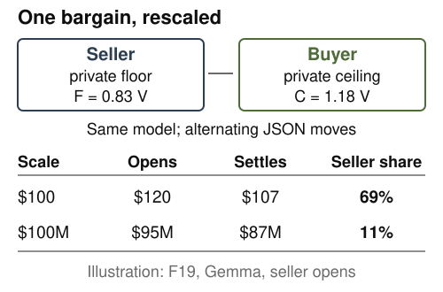
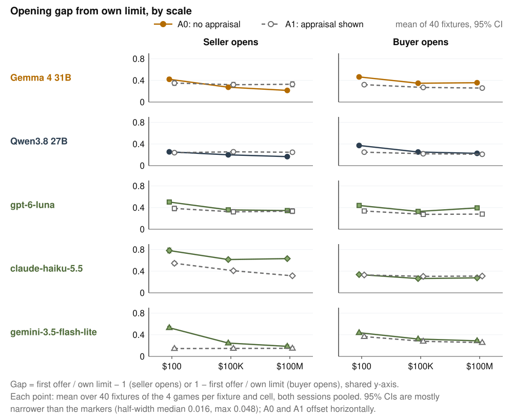
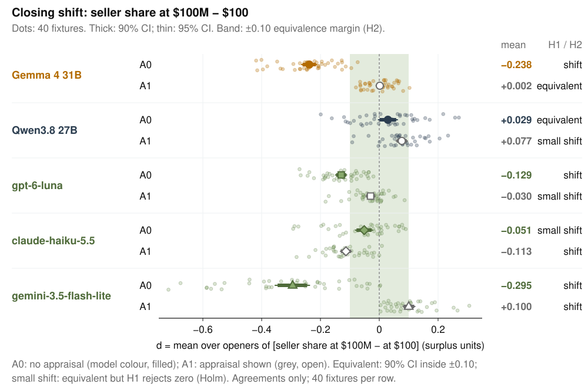
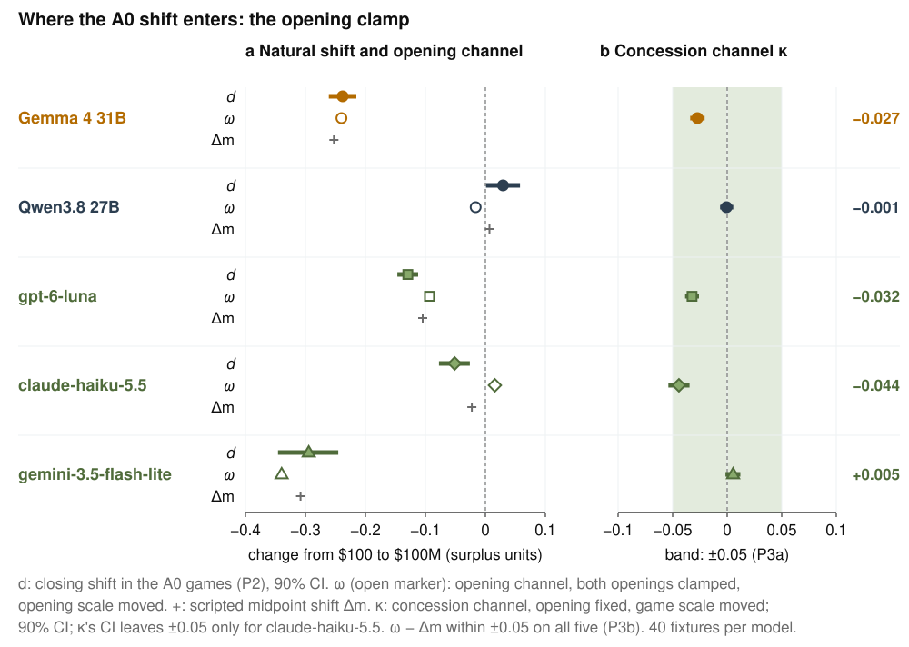
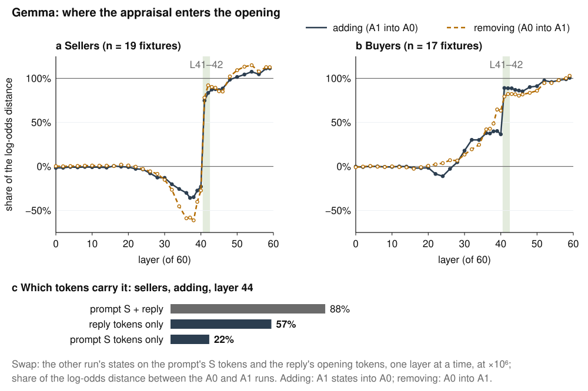

# Multiply by a Million: Scale Invariance in LLM Negotiators

**Author:** [Matt E. West](https://shelltoho.me/) ([Google Scholar](https://scholar.google.com/citations?user=khPjLQcAAAAJ&hl=en) · [GitHub](https://github.com/xmattwest) · [Hugging Face](https://huggingface.co/mattyxcakes) · [ORCID](https://orcid.org/0009-0008-5557-9394) · [X](https://x.com/xmattwest) · [LinkedIn](https://www.linkedin.com/in/matt-e-west))

- **Interactive Web Edition:** [https://shelltoho.me/pubs/multiply-by-a-million/](https://shelltoho.me/pubs/multiply-by-a-million/)
- **Main Paper (14 pages, Sections 1-9 + References):** [`papers/multiply-by-a-million.pdf`](papers/multiply-by-a-million.pdf) · [`papers/multiply-by-a-million.md`](papers/multiply-by-a-million.md)
- **Supplementary Appendix (38 pages, Appendices A-F):** [`papers/appendix.pdf`](papers/appendix.pdf) · [`papers/appendix.md`](papers/appendix.md)

---

## Abstract

People take more risk with small stakes and discount large amounts less; we ask whether LLM negotiators, whose task is identical at every scale, also respond to scale. We test this in a confirmatory study of five models (`Gemma 4 31B`, `Qwen3.8 27B`, `gpt-6-luna`, `claude-haiku-5.5`, and `gemini-3.5-flash-lite`), each playing `3,200` self-play games (`16,000` games total) on `40` randomly drawn price ranges at `$100`, `$100K`, and `$100M`, with and without a public appraisal of the lot and with an opening clamp that scripts both first offers.

Without the appraisal, every model opens closer to its own limit at `$100M`. On all five, deals follow the scripted openings' midpoint. The appraisal reduces the opening effect on four models and removes Gemma's closing shift (from `-0.238` to `+0.002` of the surplus), but it is not a general remedy: it reverses the shift on Gemini (`+0.100`) and enlarges it on Haiku (`-0.113`). Mechanistically, patching and steering inside `Gemma 4 31B` (`E5`, `E6`) show that the appraisal takes over Gemma's opening at `Layer 41` of `60`, on the tokens that write the price, through attention heads that largely also carry the scale and private-range effects, while a shared abstract magnitude representation emerges by `Layer 5` without transferring negotiation stake sensitivity to risky-choice gambles. Evaluating an agent at one numerical scale does not certify it at another.



| Opening Modesty Across Scale (`P1`) | Closing Surplus Shift (`P2`) |
| :---: | :---: |
|  |  |

| Scripted Opening Clamp (`P3`) | Inside Gemma 4 31B (`E5` Appraisal Circuit) |
| :---: | :---: |
|  |  |

---

## Repository Contents

This repository contains only the materials supporting the *Multiply by a Million* publication:

- **[`papers/multiply-by-a-million.pdf`](papers/multiply-by-a-million.pdf) & [`papers/multiply-by-a-million.md`](papers/multiply-by-a-million.md):** Main manuscript (Sections 1-9 and References).
- **[`papers/appendix.pdf`](papers/appendix.pdf) & [`papers/appendix.md`](papers/appendix.md):** Separate Supplementary Appendix (Appendices A-F: registration and freeze audit, full Study 3 tables, protocol and prompt templates, discovery phase Studies 1-2 and Addenda A-C, E5 mechanistic methods/results, and E6 number-vs.-stakes methods/results).
- **[`prereg/study3/`](prereg/study3/):** Confirmatory Study 3 protocol ([`PREREGISTRATION.md`](prereg/study3/PREREGISTRATION.md)), 37 frozen file hashes ([`inputs.sha256`](prereg/study3/inputs.sha256)), scripted opening clamp values ([`clamp_values.json`](prereg/study3/clamp_values.json)), and interim/final [`DATA_ACCESS.md`](prereg/study3/DATA_ACCESS.md) log. Discovery-phase registrations live in [`prereg/`](prereg/).
- **[`config/interp/`](config/interp/):** Pre-committed mechanistic predictions written before execution for [`e5_predictions.md`](config/interp/e5_predictions.md) and [`e6_predictions.md`](config/interp/e6_predictions.md), plus model revision pins in [`config/pins.json`](config/pins.json).
- **[`derived/`](derived/) & [`data/`](data/):** Registered five-model Study 3 outcomes ([`derived/study3/study3.json`](derived/study3/study3.json)), discovery-phase derived summaries, session manifests/summaries (`data/runs/`), and Gemma 4 31B E5/E6 mechanistic summaries (`data/interp/`).
- **[`scripts/`](scripts/) & [`tests/`](tests/):** Bargaining engine (`game_engine.py`), deterministic fixture generator (`make_fixtures.py`), Study 3 runner and frozen statistical analysis (`study3.py`, `run_study3.py`, `analyze_study3.py`), Gemma 4 31B activation-patching and steering suite (`scripts/interp/`), figure/table builders (`manuscript/figures/`), and verification tests.

---

## Verification

Verify all 37 frozen Study 3 file SHA-256 digests and run the Study 3 + E5/E6 test suites (Python 3.11+, standard library for Study 3):

```bash
shasum -a 256 -c prereg/study3/inputs.sha256
python3 -m unittest tests/test_game_engine.py tests/test_render_prompt.py tests/test_run_records.py tests/test_interp_e5.py tests/test_interp_e6.py
```

---

## License

Code (`scripts/`, `tests/`) is released under the **MIT License**. Manuscript files (`papers/`), figures (`manuscript/figures/`), pre-registrations (`prereg/`), and derived data (`derived/`, `data/`) are released under **CC BY 4.0**. See [`LICENSE`](LICENSE).
