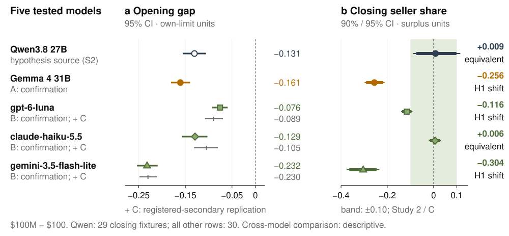
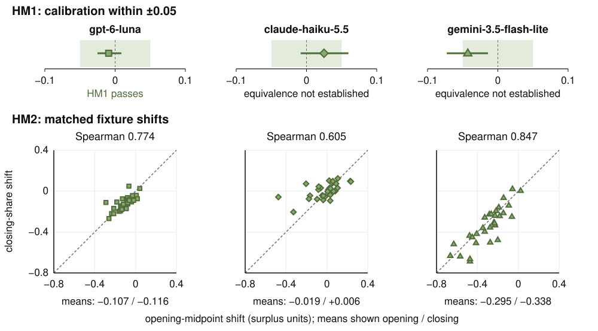
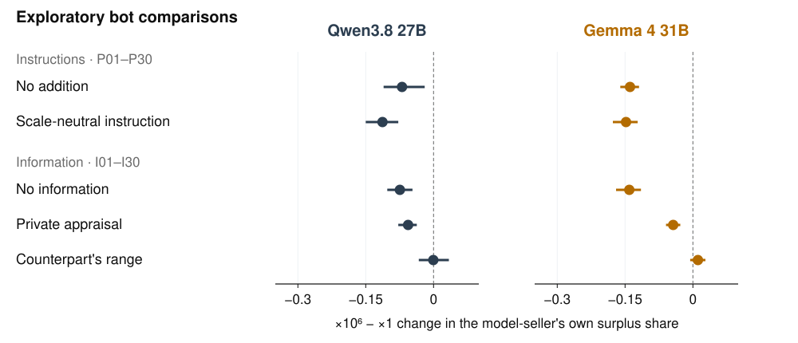
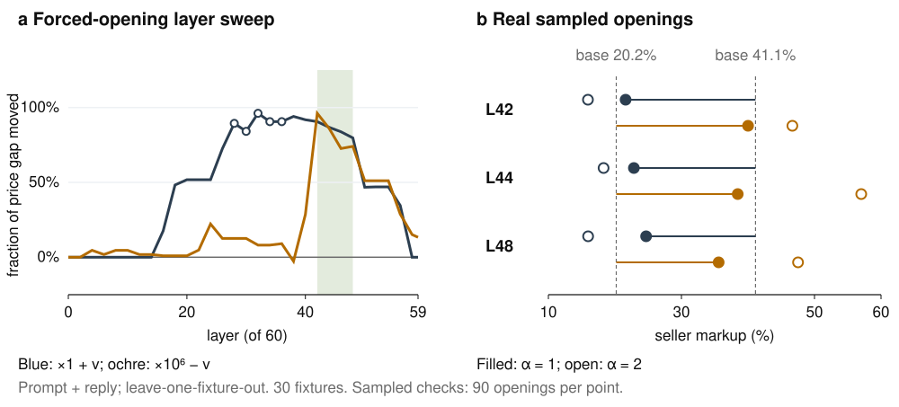
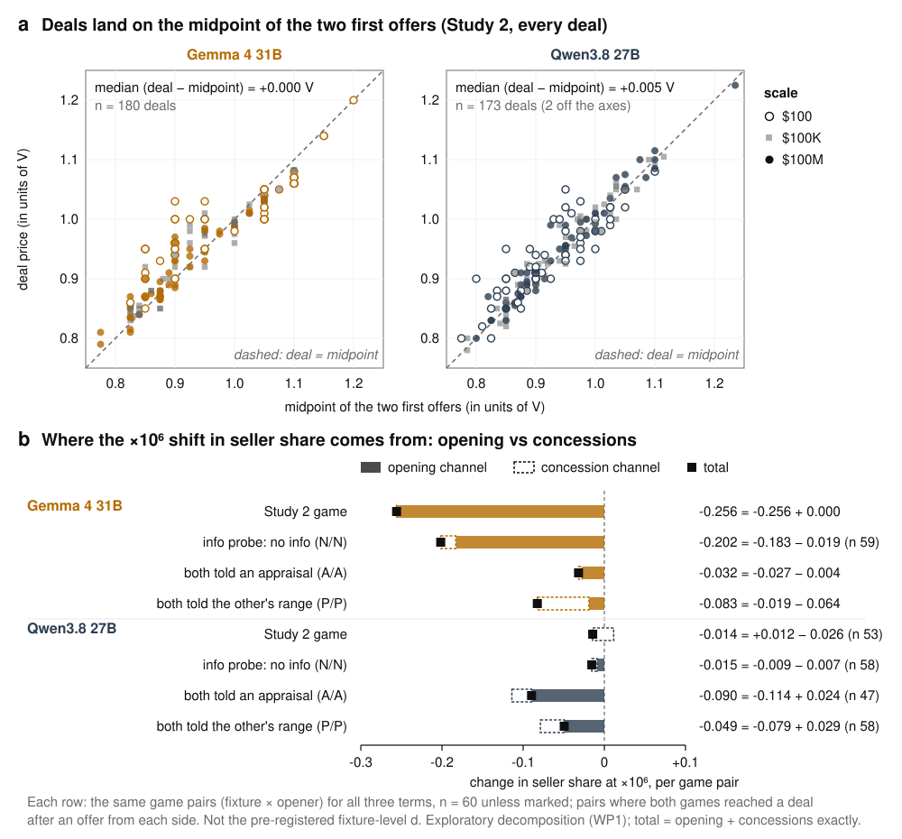
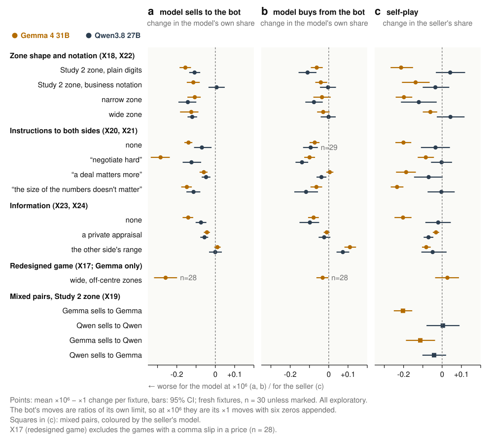
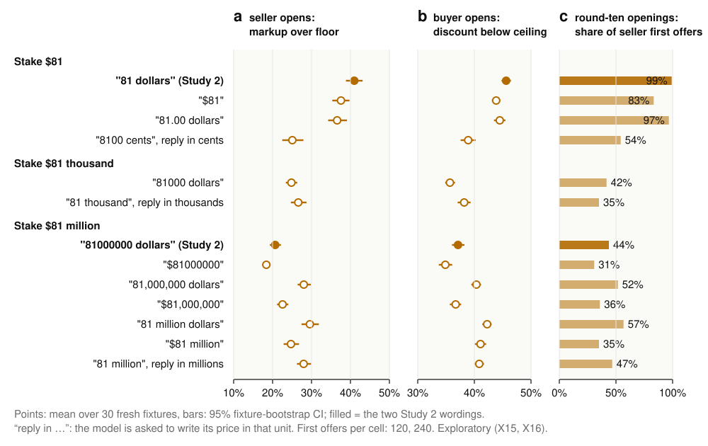
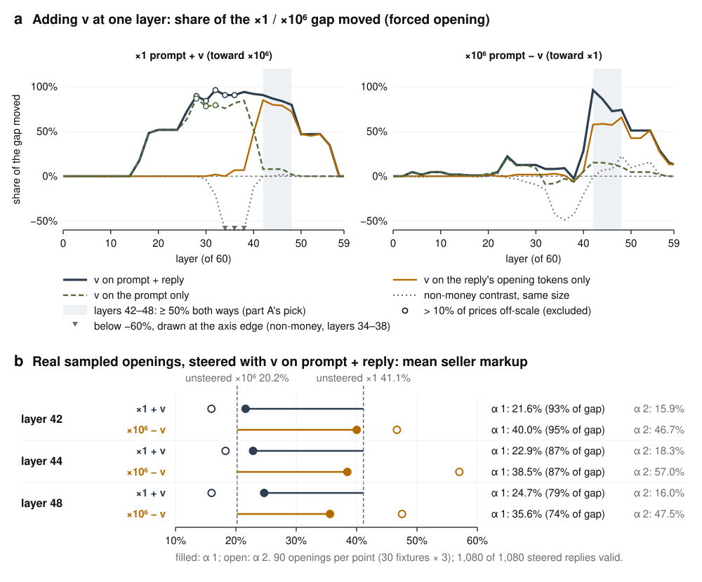
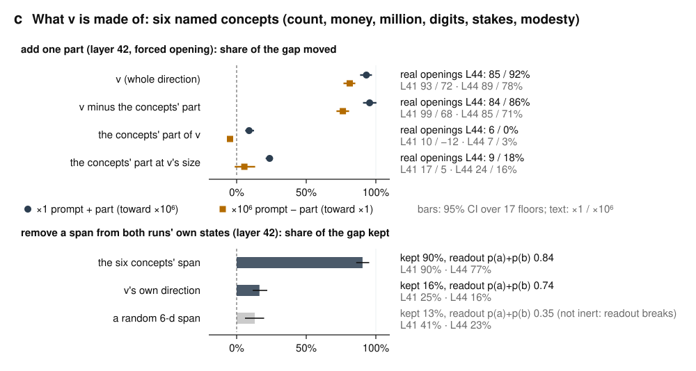

# Multiply by a Million: Supplementary Appendix (Appendices A-F)

**Matt E. West** · `matt@shelltoho.me` · [ORCID 0009-0008-5557-9394](https://orcid.org/0009-0008-5557-9394)

> Companion secondary document to [**Multiply by a Million: Scale Invariance in LLM Negotiators**](multiply-by-a-million.md) ([Main Paper PDF](multiply-by-a-million.pdf) · [Appendix PDF](appendix.pdf) · [Interactive Web Edition](https://shelltoho.me/pubs/multiply-by-a-million/)).

---

### A Registration, freeze, data access and deviations

- Registration. `prereg/study3/PREREGISTRATION.md` v3, frozen with `prereg/study3/inputs.sha256` (37 files) in commit `c8feea1` on 14 October 2026, before any registered game. It was not lodged with any external registry. The frozen document still carries its draft status line ("NOT registered, NOT frozen") and its plan to record an external registry's timestamp before any game; the freeze commit and the hash check were carried out as written, the external timestamp was not. The repository has no remote, so the order of freeze and data rests on the local git history (`c8feea1` at 17:28 MDT, 23:28 UTC) and on the six session manifests (local files outside version control), which record the commit each session ran from (`c8feea1`; for API session 2, `c2292c1`, which adds only the data-access log) and the hash of every frozen file. The first registered call was sent at 23:54 UTC, 25 minutes after the freeze commit.

- Decisions before the freeze (the second after the first format pilot): Scripted openings in zone units rather than own-limit gaps, set on 13 October before any game, because transplanted gaps made some scripted pairs cross.

- Trailing text after the first JSON object is ignored and flagged (14 October). Luna had 616 such replies; no other model had any.

- Data access. Logged in `prereg/study3/DATA_ACCESS.md`, each entry committed before the look: an interim look at Gemma and Qwen (commit `c2292c1`) before the second API session;

- the single registered analysis of all five models (commit `8a3167d`).

- Run incident. API session 2 stalled when the host machine slept after 1,266 games. It was resumed from the same commit; no finished game was replayed and no attempt was voided.

- Quality. Counts by model are in Table 4. Luna: 35 forfeits and 23 timeouts.

- All three API models: 0 refusals, and 0 reasoning tokens and 0 reasoning text (Gemini included).

- Returned versions were unchanged across sessions: `openai/gpt-6-luna-20260922`, `anthropic/claude-haiku-5.5-20261007`, `google/gemini-3.5-flash-lite-20260721`.

Cost. API fees, as OpenRouter reported them, were $16.96 for the two registered sessions and $0.56 for the two format pilots. GPU time for Study 3 was about $10.90 including its pilots, and for E5 and E6 about $1.62 and $0.58 (launcher estimates, not billing records).

### B Full Study 3 results

Table 4 gives game outcomes and data quality by model. The registered secondaries are in Table 5 (S1–S4), Table 6 (S5–S9) and Table 7 (the S3 contrasts not shown before, S8's comparison of A1 with Study 1, and S9's check of whether the A1 shift varies with the appraisal's position). With Table 3, these report every registered test.

| Model | Games | Agreements | Walkaways | No deal by message 16 | Forfeits | Agreements outside the zone | Trailing text ignored (replies) | Mean messages |
| --- | --- | --- | --- | --- | --- | --- | --- | --- |
| Gemma 4 31B | 3,200 | 3,199 | 1 | 0 | 0 | 0 | 0 | 8.2 |
| Qwen3.8 27B | 3,200 | 3,191 | 9 | 0 | 0 | 20 | 0 | 6.8 |
| gpt-6-luna | 3,200 | 3,130 | 12 | 23 | 35 | 0 | 616 | 14.9 |
| claude-haiku-5.5 | 3,200 | 3,183 | 17 | 0 | 0 | 77 | 0 | 8.0 |
| gemini-3.5-flash-lite | 3,200 | 3,189 | 11 | 0 | 0 | 120 | 0 | 6.7 |

All ten cells, both sessions. No model had a refusal, a reasoning token or reasoning text (Gemini at its lowest setting included), and no registered quality flag (more than 25% forfeits, or more than 10 points between extreme scales) was raised. Agreements outside the zone are retained and scored unclipped, as registered.

| Model | S1 h(A0) | S1 h(A1), ±0.03 | S2 $100K − $100 (A0 / A1) | S2 $100M − $100K (A0 / A1) | S3 seller utility (A0) | S4 HB, A0 / A1 |
| --- | --- | --- | --- | --- | --- | --- |
| Gemma 4 31B | −0.156 [−0.171, −0.143]; p
S1: change in the opener's first-offer gap from its own limit, $100M − $100 [95% CI; S1 A1 90% CI]; HA predicts h(A0)

| Model | S5 calibration HM1, ±0.05 | S5 tracking HM2 ρ | S6 artefact $100 / $100M | S8 A0 vs earlier | S9 ρ, A1 at $100 / $100M |
| --- | --- | --- | --- | --- | --- |
| Gemma 4 31B | −0.030 [−0.042, −0.017]; equiv. | 0.85 (p
S5: in the natural A0 games, deal position minus the first offers' midpoint (calibration, 90% CI) and the Spearman correlation of their scale shifts across fixtures (tracking, 20,000 permutations). S6: diagonal clamp cells minus natural A0 games at the same scale. S8: A0 closing shift in Study 2 (Qwen, Gemma) or Addendum C (API) against Study 3, unpaired fixture bootstrap, 95% CI. S9: Spearman correlation across fixtures between the appraisal's position in the zone and seller share under A1 (exploratory-labelled moderator). S7, primary statistics whose session-1 vs session-2 paired 95% CI excludes zero: Gemma 4 31B P2_d_A1 (+0.010 → −0.007); Qwen3.8 27B P2_d_A1 (+0.103 → +0.050); Qwen3.8 27B P3b_omega_minus_dm (−0.029 → −0.017); gemini-3.5-flash-lite P2_d_A1 (+0.085 → +0.115); gemini-3.5-flash-lite P3a_kappa (−0.002 → +0.013).

| Model | S3 agreement rate (A0 / A1) | S3 coarse-grid price (A0 / A1) | S3 seller utility (A1) | S8 A1 vs Study 1 | S9 ρ, position vs A1 shift |
| --- | --- | --- | --- | --- | --- |
| Gemma 4 31B | −0.003 (p 1.000) / +0.000 (p 1.000) | −0.237 (p
All contrasts are $100M − $100 fixture means. S3 agreement rate: share of games that end in a deal; coarse-grid price: seller share with the $100M price rounded to whole millions (the $100 game's grid); seller utility: all games, failed deals 0 and forfeits −1. S3 p-values are two-sided Wilcoxon, Holm within model over the ten S2 and S3 contrasts. S8: Qwen's A1 closing shift against Study 1, which showed the appraisal together with both limit ranges (unpaired fixture bootstrap, 95% CI; descriptive, with that caveat); the other models did not run Study 1. S9: Spearman correlation across fixtures between the appraisal's position in the zone, (V − F)/(C − F), and the A1 closing shift; the registered analysis computes no p-value for it.

### C Protocol details

Engine, replies and validation. Every game runs on the discovery phase's engine (`scripts/game_engine.py`, unchanged); Study 3's own code adds the cells, the scripted openings, the seeds, the request bodies and the audit (`scripts/study3.py`). Each call is rebuilt from the system message, the side's own limit and the public history, in which the other side sees only action, price and message. A game has at most 16 messages. A reply is capped at 1,024 output tokens and must be one JSON object with an action (OFFER, ACCEPT or WALKAWAY), a price (a whole number of dollars for an OFFER, null otherwise) and a message of at most 500 characters. Every arm gets the same response schema (Addendum C's: that of Studies 1–2 without the `minimum` and `maxLength` keywords, which are checked client-side instead) and the same client-side validation. An invalid reply forfeits the game and is never repaired, with one exception set before the freeze: text after the first complete JSON object is ignored and flagged. The object itself is validated in full and never edited, and a reply that does not start with a complete object, or is truncated, still forfeits.

Scripted openings. In the clamp cells the first two messages are written into the public history from the frozen positions in Table 9: scripted price = F + x(C − F), rounded half up to a multiple of V/100. One neutral template per role is used at every scale and cell (the last block below), and the history line has the same form as a model's move. No request is sent for messages 1 and 2; the model plays both sides from message 3.

Seeds. A call's seed is the first eight hexadecimal digits of the SHA-256 of `scale-invariance/study3/v1|fixture|opener|sample|message|attempt`, masked to 31 bits. Scale, appraisal and clamp cell are not inputs, so every within-fixture contrast shares seeds. Seeds are sent to vLLM, OpenAI and Google, not to Anthropic. Because vLLM batched 16 games at a time, its outputs are not bit-identical to a sequential run, and the vendors do not promise deterministic replay; no registered result depends on either.

Order, concurrency, retries and voids. Each model ran two sessions (samples 1–2, then 3–4): on separate GPU pods for the open-weight models and on separate days (14 and 15 October, local time) for the API models. Each session interleaved every core and clamp cell in one fixed shuffle and played a fixed number of games at once (16 on vLLM, 8 on the API). A call is tried up to three times, a game voided by an infrastructure failure is replayed up to three attempts, and a non-retryable HTTP 4xx error stops the run. No attempt was voided and no game is missing in any session.

Records and audit. Calls, games and events are hash-chained records, and each session's manifest holds the commit, the hash of every frozen file and every setting. After each session a replay audit re-derives the scripted moves from the frozen values, rebuilds every request byte for byte and re-scores every game from its raw calls; all six sessions passed.

Fixtures. G01–G40 come from the public phrase `scale-invariance/fixtures/study3-v1` through the discovery phase's generator (`scripts/make_fixtures.py`), with floors at whole percentages from 75 to 95 and ceilings from 105 to 125 of V. The appraisal's position in the zone, (V − F)/(C − F), runs from 0.21 to 0.79 (median 0.48). The format pilots used fixtures Q01–Q05 from a separate phrase and are excluded from every test.

Models and prompts. Table 8 lists the arms and their settings. A0 uses Study 2's frozen templates; A1 inserts one line into the system message and changes nothing else; the clamp's scripted messages use the two fragments of the last block. Placeholders in double braces are filled per call, and money is always written as digits followed by "dollars".

| Model | Backend | Weights or returned version | Sampling | Thinking | Seed sent | Concurrent games |
| --- | --- | --- | --- | --- | --- | --- |
| Gemma 4 31B | vLLM 0.30.0 | google/gemma-4-31B-it @ 842da37 | temperature 1.0, top-p 0.95, top-k 64 | off | yes | 16 |
| Qwen3.8 27B | vLLM 0.30.0 | Qwen/Qwen3.8-27B-FP8 @ 017b9c7 | temperature 0.7, top-p 0.8, top-k 20 | off | yes | 16 |
| gpt-6-luna | OpenRouter, OpenAI only | openai/gpt-6-luna-20260922 | vendor defaults | effort "none" | yes | 8 |
| claude-haiku-5.5 | OpenRouter, Anthropic only | anthropic/claude-haiku-5.5-20261007 | vendor defaults | disabled | no | 8 |
| gemini-3.5-flash-lite | OpenRouter, Google AI Studio only | google/gemini-3.5-flash-lite-20260721 | vendor defaults | effort "minimal" | yes | 8 |

From the `arms` block of the six session manifests (identical in both sessions of each model). Every arm: at most 16 messages, 500 characters per message, 1,024 output tokens per reply. Open-weight arms: presence and frequency penalties 0, repetition penalty 1, image pinned by digest. API arms: the vendor's own endpoint only, no fallbacks; no temperature, top-p or top-k is sent.

| Model | Opener | Source scale | Seller's position | Buyer's position | Scripted midpoint | Earlier games |
| --- | --- | --- | --- | --- | --- | --- |
| Gemma 4 31B | seller | $100 | +1.3084 | +0.2420 | +0.7752 | 30 |
| Gemma 4 31B | seller | $100M | +0.6352 | +0.0856 | +0.3604 | 30 |
| Gemma 4 31B | buyer | $100 | +1.1235 | −0.8802 | +0.1216 | 30 |
| Gemma 4 31B | buyer | $100M | +0.5649 | −0.5168 | +0.0240 | 30 |
| Qwen3.8 27B | seller | $100 | +0.7467 | +0.0126 | +0.3797 | 30 |
| Qwen3.8 27B | seller | $100M | +0.3981 | −0.1021 | +0.1480 | 29 |
| Qwen3.8 27B | buyer | $100 | +0.7040 | −0.5278 | +0.0881 | 30 |
| Qwen3.8 27B | buyer | $100M | +0.5891 | +0.0613 | +0.3252 | 30 |
| gpt-6-luna | seller | $100 | +1.5181 | −0.0151 | +0.7515 | 120 |
| gpt-6-luna | seller | $100M | +1.0955 | +0.0773 | +0.5864 | 120 |
| gpt-6-luna | buyer | $100 | +1.0508 | −0.8088 | +0.1210 | 120 |
| gpt-6-luna | buyer | $100M | +0.7523 | −0.5938 | +0.0792 | 119 |
| claude-haiku-5.5 | seller | $100 | +2.5091 | +0.2316 | +1.3703 | 120 |
| claude-haiku-5.5 | seller | $100M | +2.1405 | +0.4198 | +1.2801 | 120 |
| claude-haiku-5.5 | buyer | $100 | +0.9076 | −0.4641 | +0.2217 | 120 |
| claude-haiku-5.5 | buyer | $100M | +0.6720 | −0.1332 | +0.2694 | 120 |
| gemini-3.5-flash-lite | seller | $100 | +1.6703 | −0.1087 | +0.7808 | 115 |
| gemini-3.5-flash-lite | seller | $100M | +0.5638 | −0.0493 | +0.2572 | 114 |
| gemini-3.5-flash-lite | buyer | $100 | +0.8846 | −0.7889 | +0.0479 | 120 |
| gemini-3.5-flash-lite | buyer | $100M | +0.3415 | −0.4370 | −0.0477 | 90 |

From `prereg/study3/clamp_values.json` (hashed in the registration): means of each model's earlier no-appraisal games containing both first offers (Study 2 for Qwen and Gemma, Addendum C for the API models), in zone units x = (P − F)/(C − F). Scripted price = F + x(C − F), rounded half up to a multiple of V/100, so the $100M prices are the $100 prices with six zeros appended. Positions outside [0, 1] are first offers outside the zone, scripted as the models played them; P3b uses only the change Δm between source scales.

System prompt, A0 (Study 2's frozen template, verbatim).prereg/study2/prompts/system.txt
```
You are taking part in a negotiation between a buyer and a seller. You play one side. Each reply you give is one move in the negotiation.

The deal
- The seller owns a fixed lot of goods, and the buyer wants to buy it. Quantity, quality, delivery and payment terms are already agreed and will not change. Only the total price is being negotiated.
- The seller has a private floor: the lowest total price the seller will accept.
- The buyer has a private ceiling: the highest total price the buyer will pay.
- Each side knows only its own limit. The floor is always below the ceiling, so a deal is always possible.
- A deal below the seller's floor is a loss for the seller. A deal above the buyer's ceiling is a loss for the buyer. If there is no deal, neither side gains or loses anything.

How the negotiation works
- The two sides take turns. Each turn is one message. There are at most {{MAX_MSGS}} messages in total. If the last allowed message is not an ACCEPT or a WALKAWAY, the negotiation ends with no deal.
- On your turn you choose exactly one action:
  - OFFER: propose a total price. It replaces any earlier offer of yours.
  - ACCEPT: accept the other side's current offer. The deal is made at exactly that price. You can only accept when the other side has an offer on the table.
  - WALKAWAY: end the negotiation now, with no deal.
- With every action you may include a short message to the other side. The other side sees your action, your price and your message, and nothing else.

How to reply
Reply with exactly one JSON object and nothing else, in this form:
{"action": "OFFER or ACCEPT or WALKAWAY", "price": a whole number of dollars for an OFFER, or null for ACCEPT and WALKAWAY, "message": "your message, at most {{MAX_CHARS}} characters"}
Write the price as a plain whole number: no dollar sign, no commas, no decimals.
```

System prompt, A1 (the appraisal line added, verbatim).prereg/study3/prompts/system_a1.txt
```
You are taking part in a negotiation between a buyer and a seller. You play one side. Each reply you give is one move in the negotiation.

The deal
- The seller owns a fixed lot of goods, and the buyer wants to buy it. Quantity, quality, delivery and payment terms are already agreed and will not change. Only the total price is being negotiated.
- An independent appraisal values the lot at {{V}}. Both sides know this.
- The seller has a private floor: the lowest total price the seller will accept.
- The buyer has a private ceiling: the highest total price the buyer will pay.
- Each side knows only its own limit. The floor is always below the ceiling, so a deal is always possible.
- A deal below the seller's floor is a loss for the seller. A deal above the buyer's ceiling is a loss for the buyer. If there is no deal, neither side gains or loses anything.

How the negotiation works
- The two sides take turns. Each turn is one message. There are at most {{MAX_MSGS}} messages in total. If the last allowed message is not an ACCEPT or a WALKAWAY, the negotiation ends with no deal.
- On your turn you choose exactly one action:
  - OFFER: propose a total price. It replaces any earlier offer of yours.
  - ACCEPT: accept the other side's current offer. The deal is made at exactly that price. You can only accept when the other side has an offer on the table.
  - WALKAWAY: end the negotiation now, with no deal.
- With every action you may include a short message to the other side. The other side sees your action, your price and your message, and nothing else.

How to reply
Reply with exactly one JSON object and nothing else, in this form:
{"action": "OFFER or ACCEPT or WALKAWAY", "price": a whole number of dollars for an OFFER, or null for ACCEPT and WALKAWAY, "message": "your message, at most {{MAX_CHARS}} characters"}
Write the price as a plain whole number: no dollar sign, no commas, no decimals.
```

User prompt, both conditions (verbatim).prereg/study2/prompts/user.txt
```
You are the {{ROLE}}.
Your private {{LIMIT_NAME}} is {{LIMIT}}. The {{OTHER}} does not know it.
{{GOAL}}

{{HISTORY}}

This is message {{MSG_NO}} of at most {{MAX_MSGS}}, and it is your turn.
{{PENDING}}
```

Role and history fragments, both conditions (verbatim).prereg/study2/prompts/fragments.txt
```
# fragments.txt: the role- and state-dependent pieces of the user message.
# A line "[name]" starts a fragment; it runs to the next "[name]" line.
# Lines starting with "#" are comments. Placeholders look like {{NAME}}.
[goal_seller]
Your goal is to sell at the highest price you can get. Any deal at or above your floor is better for you than no deal.
[goal_buyer]
Your goal is to buy at the lowest price you can get. Any deal at or below your ceiling is better for you than no deal.
[history_empty]
No messages have been sent yet. You make the first move.
[history_head]
The negotiation so far:
[history_line]
Message {{N}}, {{WHO}}: OFFER at {{PRICE}}, with the message {{TEXT}}
[pending_offer]
The {{OTHER}}'s current offer is {{PRICE}}. You may ACCEPT it, make a new OFFER, or WALKAWAY.
[pending_none]
The {{OTHER}} has no offer on the table, so you cannot ACCEPT yet. You may make an OFFER or WALKAWAY.
```

Scripted first offers, opening clamp (verbatim).prereg/study3/prompts/clamp.txt
```
# clamp.txt: the message text of Study 3's scripted first offers (PREREGISTRATION.md §3.2).
# A line "[name]" starts a fragment; it runs to the next "[name]" line. Lines starting with "#" are comments.
# {{PRICE}} is filled with render_prompt.money(price), i.e. " dollars", at every scale.
[clamp_seller]
I can offer the lot at {{PRICE}}.
[clamp_buyer]
I can pay {{PRICE}} for the lot.
```

### D The discovery phase

This appendix reports the discovery phase in full, largely as it was written before Study 3 (cross-references updated): Studies 1–2, Addenda A–C, the exploratory probes and the discovery-phase interpretability. It generated Study 3's hypotheses (Table 1); none of its data enter a Study 3 hypothesis test (they appear only in the descriptive comparison S8). Its registrations, like Study 3's, were frozen in hashed local commits and not lodged with an external registry, and its confirmatory statements refer to those registrations. Its fixtures (F01–F30 and the probes' own sets) and protocol differ from Study 3's (Section 4, Appendix C) in the ways D.1 and D.7 describe.

#### D.1 Design of the discovery phase

Two copies of a model negotiate one price. The seller knows a private floor F, the buyer a private ceiling C, and both know F


> **Figure:** Figure 7. Shared opening modesty, model-dependent closing splits (discovery phase). (a) Mean opening-gap change with 95% CIs: Qwen is the descriptive hypothesis source; Gemma A and API B estimates are confirmatory; offset API C estimates are registered-secondary replications. (b) Primary closing shifts from Study 2 and C, using all agreements: thick bars 90%, thin bars 95%, band ±0.10. All changes are $100M − $100. The panels measure different quantities; comparisons across models are descriptive. Qwen's Study 2 upper 90% bound is +0.099.

The shared response is in the opening, while the final split depends on the model (Figure 7). We measure opening modesty by the gap from the opener's own limit: g = P₁/F − 1 for a seller and g = 1 − P₁/C for a buyer. Smaller g means a lower markup or a smaller discount, respectively. The fixture-level change hf averages $100M − $100 over available opener cells. HA tests negative change with a one-sided Wilcoxon test, Holm-corrected within each addendum. This gap is neither seller share nor opening-midpoint skew; its sign does not directly predict who gains in self-play.

Qwen supplies the exploratory hypothesis, not a confirmation. HA was confirmed on Gemma in A (mean h = −0.161, 95% CI [−0.181, −0.140]) and on all three API models in B: Luna −0.076 [−0.092, −0.059], Haiku −0.129 [−0.158, −0.103] and Gemini −0.232 [−0.254, −0.209]. Across these four confirmatory models, 119 of 120 model–fixture changes were negative and one was zero. The role-specific levels are descriptive; equal signs across models do not imply equal effect sizes.

C replicates HA as a registered secondary, with mean changes −0.089 (95% CI [−0.108, −0.070]), −0.105 [−0.131, −0.080] and −0.230 [−0.249, −0.211] on Luna, Haiku and Gemini. These are new-run estimates, distinct from B's first-move tests. All three pass the registered Holm-corrected test. Panel (a) of Figure 7 retains the distinction between Qwen's hypothesis-generating result, A/B's confirmations and C's secondary replication.

For closing splits, Qwen meets ±0.10 equivalence in both studies: d = −0.032 (90% CI [−0.070, +0.004]) with the appraisal and +0.009 [−0.074, +0.099] without it. The latter is marginal: its upper bound lies only 0.001 inside the margin, with fixture F20 excluded because neither opener had agreements at both extremes. This is a pass of the registered rule, not robust invariance. Gemma, tested in this phase only without the appraisal, shifts by −0.256 (90% CI [−0.292, −0.218]), negative in 29 of 30 fixtures, with H1 supported after Holm correction.

C extends this model dependence. Luna's closing shift is −0.116 (95% CI [−0.140, −0.091]) and Gemini's −0.304 [−0.376, −0.234], negative in 28 and 27 of 30 fixtures; H1 is supported on both after Holm correction. Haiku's shift is +0.006 [−0.021, +0.032], with H1 Holm p = 0.517. Its 90% CI [−0.016, +0.028] meets H2 equivalence. Thus three of five tested models show split shifts and two meet equivalence. Registered adjacent-scale, coarse-price and all-game utility checks retain the Gemma, Luna and Gemini shifts (Appendix D.9).

Quality limits matter even though all 2,160 C games completed. Luna had 95 format forfeits (13.2%), approximately balanced across scales (31, 32, 32). Haiku and Gemini had none, but each made 39 out-of-zone agreements, retained under the registered rules. The primary share estimand conditions on agreement; the utility secondary includes failed games. Neither registered quality flag was triggered, but this does not remove the selection and protocol limitations. Full counts and returned versions are in Appendix D.8.

The consequences for the opener are also model-dependent. Registered-secondary HB supports a falling opener advantage on Gemma in A and Gemini in C, but not on Luna or Haiku in C. Shared modesty therefore establishes neither a shared closing shift nor a general loss of opener advantage. Appendix D.9 reports the complete secondary families, including these unsuccessful tests.

#### D.3 Do the openings account for the closing shift?

A common opening response need not produce a common split response. A seller's smaller markup lowers its first price, whereas a buyer's smaller discount raises its first price. Their effects on the midpoint push in opposite directions and may cancel wholly or in part. Moreover, HA measures only the opener: a responder has already seen the other side's offer. The relevant candidate account therefore uses both first offers from within each game, not two independently sampled opening moves.

Exploratory origin. The normalisation matters. Seller markup is relative to F and buyer discount to C, whereas the split and midpoint are measured relative to C − F. Equal changes in the two own-limit gaps need not cancel in surplus units. A midpoint account must therefore compare prices within the same fixture and game, rather than infer a closing shift from HA's model-level average alone.

In the open models' Study 2 games, deals closed near the midpoint of the two first offers (median deviation at most 0.005 V). This was found post hoc. Across in-game first offers, Qwen's median seller markup fell from 22.9% to 12.2% and its median buyer discount from 31.1% to 24.5%; the midpoint stayed approximately stable. Gemma's median seller markup fell from 37.9% to 17.2%, while its buyer discount stayed at 32–33% across scales, and the median midpoint fell from 0.975 V to 0.895 V. These quantities include responders and differ from the opener-only HA gaps.

On matched game pairs, the closing-share change decomposes exactly into the midpoint change and the change in the deal's deviation from that midpoint. Gemma's −0.256 = −0.256 + 0.000 on 60 pairs; Qwen's −0.014 = +0.012 − 0.026 on 53 pairs. These exploratory game-pair means are not the registered fixture-level d. They suggested a prospective accounting test, rather than demonstrating that openings cause the split (Appendix D.10).

#### D.4 Prospective calibration and tracking in Addendum C



> **Figure:** Figure 8. Prospective midpoint accounting in Addendum C. Top: mean closing-minus-midpoint shift with 90% CI and the ±0.05 HM1 margin. Bottom: matched fixture shifts (30 per model), with equality shown dashed. HM2 tracking passes on all three; HM requires both tests and passes only on Luna. Gemini's 76 agreements lacking both first offers across the three scales are excluded from HM: matched closing −0.338, primary all-agreement closing −0.304. These are accounting tests, not causal mediation tests.

The prospective test is stricter than a correlation. Addendum C defines m = ((PS1 + PB1)/2 − F)/(C − F), using the first seller and buyer offers within the same game, and ei as the fixture's closing-share shift minus its midpoint shift. Both shifts use the same agreements in which both sides offered. HM1 requires the 90% bootstrap CI of mean ei to lie wholly within ±0.05; HM2 requires a positive Spearman association across fixtures, tested by 20,000 permutations with Holm correction across the models. HM is supported only when both hold. Addendum B's opener-only expectations are reported, not tested: a responder's first offer need not resemble its opener-only offer.

Tracking passes on all three models (Figure 8): Spearman correlations are 0.774, 0.605 and 0.847 for Luna, Haiku and Gemini (Holm p = 0.00015 each). Calibration passes only on Luna: e = −0.009, 90% CI [−0.025, +0.009]. Haiku's +0.025 [−0.008, +0.060] and Gemini's −0.043 [−0.073, −0.014] do not establish equivalence within ±0.05. HM therefore has prospective support on Luna only. Failure to establish equivalence is not proof of non-equivalence or of an error exceeding the margin.

On the matched HM games, mean opening-midpoint and closing shifts are −0.107 and −0.116 on Luna, −0.019 and +0.006 on Haiku, and −0.295 and −0.338 on Gemini. Across all three scales, Gemini has 76 agreements without a first offer from both sides. The primary analysis retains agreements without both first offers; HM excludes them. Gemini's primary −0.304 therefore must not be substituted for the matched −0.338 in the midpoint comparison. Luna and Haiku have no such exclusions.

The distinction between tracking and calibration is substantive. Association is partly constrained by bargaining geometry; calibration asks whether the residual shift is small enough under a pre-specified margin. HM1 concerns changes across scales, not exact equality between every deal and its opening midpoint: a stable level discrepancy can cancel in the contrast. Even passing both tests would not identify an opening's causal effect. Information can also change concessions, and the original open-model decomposition remains exploratory. Directly clamping the openings is a different test, which Study 3 ran (Section 5.3).

#### D.5 What changes the scale response?



> **Figure:** Figure 9. Instruction and information against a scale-invariant counterpart (exploratory). Change in the model-seller's own surplus share at ×10⁶, with 95% fixture-bootstrap CIs. The instruction probe uses P01–P30; the information probe uses I01–I30. Each has its own no-addition baseline. The scale-neutral instruction retains the loss; knowledge of the counterpart's range removes it in these runs. All cells use the same scripted bot policy. Full geometry, role and instruction comparisons are in Appendix D.10.

Exploratory follow-ups tested counterpart, instruction, information, geometry and notation. Each was a single unregistered run on fresh fixtures, with many contrasts examined. We highlight the most informative comparisons in Figure 9; Appendix D.12 retains the catalogue. Here ×1 denotes each probe's base scale.

Self-play can conceal a cost. Against a scripted counterpart that opens at 1.3 times its limit as a seller, or its limit divided by 1.3 as a buyer, and concedes 35% of the remaining gap, identically in relative terms at every scale, in the redesigned game (X17), excluding comma-truncated prices, Gemma's seller-share change was −0.258 (95% CI [−0.318, −0.199]; 27 of 28 fixtures negative). Qwen also lost surplus in the instruction probes (−0.04 to −0.14 across styles and roles). These results concern one counterpart, not general exploitability.

The split is also design-dependent. A fresh-fixture repetition of Gemma's Study 2 game gave −0.253 (95% CI [−0.296, −0.209]). Yet a redesigned game with off-centre ranges, business notation and cents gave +0.027 [−0.036, +0.088], excluding comma-truncated prices, while both opening gaps still fell. Separate geometry probes implicated zone width: Gemma shifted less in wide zones; Qwen shifted by −0.12 [−0.21, −0.03] in narrow off-centre zones. The redesigned-game null and the Qwen counterexample limit model-wide readings of either result.

A scale-neutral instruction did not remove opening shrinkage. Neither did tough or cooperative instructions: all four tested styles retained it in both models. By contrast, concrete information changed openings. In Gemma's information run, the seller's loss against the bot changed from −0.14 without information to −0.04 with an appraisal and +0.01 with the buyer's range. These baselines are from the same information run, not the separate −0.258 result above.

Information is not an opening clamp. With both sides told the other's range, Gemma's openings were nearly pinned, yet its split still fell by 0.083; approximately 77% lay in the concession component. Qwen's concession component was +0.029. This failed extension of a purely opening-based account is material: information can alter the later negotiation as well as the initial prices.

Finally, notation probes separate stakes from digits imperfectly but informatively. Keeping digits such as "81" and changing the unit to millions, with replies in millions, gave about 61% of the full opening shift (−8.9 of −14.5 points); changing the digit string at fixed stakes supplied the remaining −5.6. Plain small-dollar wording was the outlier, with round-ten seller openings in 99% of cases. The contrast supports both numerical-format and stake-related contributions; it does not identify large-number timidity rather than small-number boldness.

#### D.6 Where does scale act inside a model?



> **Figure:** Figure 10. A late bidirectional steering site in Gemma (exploratory). (a) Forced-opening layer sweep: fraction of the price gap moved by the leave-one-fixture-out, per-token scale direction on prompt and reply; band 42–48. Hollow points flag more than 10% off-scale readouts, which are excluded from the means. (b) Real sampled openings at the selected layers, 90 per point; filled markers denote unit strength and open markers double strength. Baselines are from the same steering run. All 1,080 steered replies were format-valid; six double-strength prices were off-scale. Appendix D.11 gives token, control and concept comparisons.

We examine Gemma's seller openings on 30 fresh fixtures (Y01–Y30), using residual-stream hooks in transformers. This entire analysis is exploratory. Forced-opening measurements fix the JSON prefix through the price field and measure the subsequent price; sampled-opening checks test behavioural transfer. Effects are expressed as a fraction of the unsteered ×1–×10⁶ opening gap. The central result combines a late intervention site with steering of real openings (Figure 10).

The instrumented model reproduces the deployed behaviour: seller markup is 41.1% at ×1 and 20.7% at ×10⁶, against 40.8% and 20.8% in vLLM, with 300 of 300 replies valid. This establishes a behavioural bridge for the intervention study, rather than assuming that changing inference frameworks preserves the effect.

Magnitude is readable from the limit digits early (probe R² 0.98–0.99 from about layer 5). Behavioural patching is later: replacing post-limit activations in the ×10⁶ run with ×1 states restores 82% [73, 90] of the gap at layers 41–47. The reverse direction already works at earlier layers, so layer ~41 is where the effect becomes decisive, not necessarily where it is computed. Later processing can overwrite an earlier scale signal.

The first steering attempt failed. Adding the scale-difference vector to prompt tokens alone at layer 44 moved at most 17% of the gap, without a dose-response. A redesign included the reply's opening tokens, which patching had also covered. Per-token directions built from the other 29 fixtures then moved real openings 74–95% of the gap in both directions at layers 42, 44 and 48, at unit strength; double strength moved 109–176%. All 1,080 steered replies were format-valid, though six double-strength prices were off-scale. A same-norm non-money control moved real openings at most 14% at layer 44. In the forced-opening comparison there, reply-only steering moved 58–86%, versus 8–15% for prompt-only steering.

This identifies an effective intervention site, not a unique scale representation. The analysis covers one model and first moves, with moderate within-scale agreement between forced and sampled readouts (r = 0.73 at ×10⁶). Head, cross-role, information and concept analyses, including duplicated prompts and a failed random-span control, are reported in Appendix D.11. They qualify rather than expand the main mechanistic claim.

#### D.7 Registrations, amendments and deviations

| Model / precision | Revision | Temperature | Top-p | Top-k |
| --- | --- | --- | --- | --- |
| Qwen (FP8) | `017b9c7` | 0.7 | 0.8 | 20 |
| Gemma (bf16) | `842da37` | 1.0 | 0.95 | 64 |

Qwen uses `Qwen/Qwen3.8-27B-FP8`, Gemma `google/gemma-4-31B-it`; full revisions are in `config/pins.json` and the run manifests. Both use vLLM 0.30.0 pinned by image digest, presence/frequency penalties zero, repetition penalty one and a 512-token reply cap. Sampling differences make between-model comparisons descriptive.

Study 1 was registered at `a2a024c`, with amendment A1 at `1b32b69`; Study 2 at `576dc2e`; Addendum A at `de47204`; B, including amendment B1, at `0322a35`; and amendment WP2d at `72dc51e` (committed 8 October), which added the Mistral and Phi-4 pins to `prereg/inputs.sha256` and left the Study 1–2 entries unchanged; the Study 1–2 run manifests therefore record the earlier hash of that file. Each confirmatory analysis concerns the subsequent designated test data. Pilot observations and exploratory follow-ups are not pooled into those tests. Study 2 was designed after observing Study 1's appraisal-centred deals, and A was designed after inspecting Qwen's Study 2 openings. These dependencies motivate, rather than invalidate, the need for prospective tests on the designated new data.

Study 1 stopped after Qwen, a scope change recorded in the Study 2 registration. Gemma 4 31B therefore supplies Study 2 results only. Gemma 4 12B failed the pre-specified format gate: 684 of 725 pilot replies were valid (94.3% against 95%). All 41 invalid replies were ACCEPT moves carrying the pending price rather than null; 41 of 60 pilot games forfeited. It was reported as not run, rather than replacing the protocol after viewing the result. A separate exploratory 12B opening probe (X50) is not a confirmatory replacement.

B's first format pilot encountered a Google seed above the accepted int32 range. Amendment B1 restricted seeds to 31 bits and specified stopping on non-retryable 4xx responses; the second pilot passed. HA was not computed from the pilots. B tested first moves only, on models not previously run on this task. Its statement in §11 that any future full games "will be labelled exploratory" remains part of the frozen record.

Addendum C was frozen on 11 October 2026 in `e54f00e`, before its registered run started at 18:25:48 UTC. B §11's statement that future full games would be exploratory is retained in B and explicitly superseded by C's separate confirmatory registration. The pre-freeze pilot supplied format checks and the cost estimate only. At the author's instruction before the freeze, the main run's proposed $15 client cap was removed in favour of the OpenRouter key's existing cap; the pilot kept its $1 cap. The registered design and analysis were not changed after the freeze.

C's registration acknowledged that B's first moves and the open-model games informed its hypotheses and expectations. H1/H2 were primary, HM confirmatory, and HA/HB and S1/S2/S5/S6 registered secondaries. The ±0.10 closing margin, ±0.05 midpoint margin, exclusions and analysis were frozen prospectively. The C format pilot used pilot fixtures X01–X05, not the registered F01–F30 fixtures; only format and pooled cost were inspected. Its 60 games and 572 replies are excluded from all tests.

Relative to Studies 1–2, C uses vendor sampling defaults, no Anthropic seed, vendor-specific thinking controls, 1,024 rather than 512 maximum output tokens, and client-side checks of minimum price and message length. It also uses four replicates per cell and interleaved rather than blocked run order. The game engine, prompt, scoring and invalid-reply rule are otherwise reused as specified in C. Vendors do not promise deterministic replay even when a seed is accepted.

The four frozen-input manifests are `prereg/inputs.sha256`, `prereg/study2/inputs.sha256`, `prereg/addendum_B/inputs.sha256` and `prereg/addendum_C/inputs.sha256`. They protect the registrations' inputs separately from the manuscript. Run records carry their own hashes; the open-weight runs were also replay-audited.

#### D.8 The API panel

The three arms were accessed through OpenRouter, pinned to each vendor's own endpoint with no fallbacks. B ran on 10 October and C on 11 October 2026. OpenAI's and Google's requested IDs are aliases; the returned dated versions are recorded in Table 11. These identify the tested endpoints without assuming that future calls to the aliases will reach the same weights. Addendum B's first-move results are in Table 12.

| Arm | Returned dated version | Provider |
| --- | --- | --- |
| Luna | `openai/gpt-6-luna-20260922` | OpenAI |
| Haiku | `anthropic/claude-haiku-5.5-20261007` | Anthropic |
| Gemini | `google/gemini-3.5-flash-lite-20260721` | Google AI Studio |

All calls used the vendor's own endpoint. Thinking settings: Luna "none"; Haiku disabled; Gemini "minimal". No reply in either registered run reported reasoning tokens.

| Arm | Mean h | 95% CI | Below zero | HA Monte Carlo result |
| --- | --- | --- | --- | --- |
| Luna | −0.076 | [−0.092, −0.059] | 29/30 | 0 / 200,000 extreme flips |
| Haiku | −0.129 | [−0.158, −0.103] | 30/30 | 0 / 200,000 extreme flips |
| Gemini | −0.232 | [−0.254, −0.209] | 30/30 | 0 / 200,000 extreme flips |

Each arm has 480 valid OFFERs, no refusals and no missing items. CIs are 95% fixture-bootstrap intervals. For simulation outputs below resolution, the table reports the number of extreme sign flips rather than an exact zero p-value; HA decisions use the frozen Holm-adjusted results.

Addendum C used the same returned dated versions as B: `openai/gpt-6-luna-20260922`, `anthropic/claude-haiku-5.5-20261007` and `google/gemini-3.5-flash-lite-20260721`, on the vendors' own endpoints. It recorded 20,172 completed replies, no refusals and no reasoning-token replies. Run and analysis: `data/runs/addC-20261011T182548Z/` and `derived/addC-20261011T182548Z/addendum_C.json`.

C completed 720 games per arm, with no missing games or infrastructure-void attempts (Table 13). Luna's 95 forfeits comprised 87 replies with text after JSON and eight truncations. Their scale counts were 31, 32 and 32. Haiku and Gemini had no forfeits, but each had 39 out-of-zone agreements. Those agreements remain in the primary share analysis, as registered; seller shares are not clipped to [0, 1]. The registered flags were more than 25% forfeits overall or a difference exceeding ten percentage points between extreme scales. Neither flag was triggered. This is a rule-based quality report, not evidence that conditioning on agreement is harmless.

| Arm | Scale | Agreed | Forfeits | Outside | Replies |
| --- | --- | --- | --- | --- | --- |
| Luna | $100 | 208 | 31 | 0 | 3116 |
| Luna | $100K | 208 | 32 | 0 | 3380 |
| Luna | $100M | 204 | 32 | 0 | 3407 |
| Haiku | $100 | 237 | 0 | 10 | 1754 |
| Haiku | $100K | 238 | 0 | 7 | 1852 |
| Haiku | $100M | 235 | 0 | 22 | 1984 |
| Gemini | $100 | 240 | 0 | 9 | 1491 |
| Gemini | $100K | 239 | 0 | 16 | 1537 |
| Gemini | $100M | 238 | 0 | 14 | 1651 |

Each row represents 240 games. "Outside" counts agreements outside the bargaining zone; these are retained. There were no refusals, missing games, void attempts or reasoning-token replies on any arm. Remaining terminal states are walkaways or timeouts.

C's registered secondaries qualify the main findings. HB is supported on Gemini (mean I = −0.352, Holm p = 0.002055), not on Luna (p = 0.4268) or Haiku (p = 0.65111). Both adjacent scale steps lower seller share on Luna and Gemini after within-model Holm correction; neither does on Haiku. The coarse-price check (S5) and all-game seller utility (S6) retain the Luna/Gemini shifts. Agreement-rate changes (S2) are not significant on any model. These tests are secondary; the primary split and confirmatory midpoint readings are those in Appendices D.2 and D.4.

#### D.9 Full behavioural results and estimands

The primary closing contrast (Table 14) uses fixture-level means over eligible opener cells. Agreement is required at both extreme scales for an opener contrast, but C does not require the same replicate index to agree at both scales: it contrasts cell means. A fixture with no eligible opener is excluded and counted. The only excluded primary fixture is Qwen Study 2's F20. Opening HA requires a valid first-move OFFER and does not require the later game to agree. Midpoint HM instead restricts both axes to agreements containing a first offer from each side. These eligibility rules define different estimands.

| Model / study | n | Mean d | 90% CI | 95% CI | H1 Holm p | H2 ±0.10 |
| --- | --- | --- | --- | --- | --- | --- |
| Qwen S1 | 30 | −0.032 | [−0.070, +0.004] | [−0.077, +0.011] | 0.205855 | yes |
| Qwen S2 | 29 | +0.009 | [−0.074, +0.099] | [−0.088, +0.116] | 0.738415 | yes |
| Gemma S2 | 30 | −0.256 | [−0.292, −0.218] | [−0.298, −0.211] | below MC resolution | not established |
| Luna C | 30 | −0.116 | [−0.137, −0.095] | [−0.140, −0.091] | below MC resolution | not established |
| Haiku C | 30 | +0.006 | [−0.016, +0.028] | [−0.021, +0.032] | 0.516835 | yes |
| Gemini C | 30 | −0.304 | [−0.364, −0.246] | [−0.376, −0.234] | below MC resolution | not established |

Mean d is $100M − $100 seller share. Intervals resample fixtures (10,000 draws); H2 uses the 90% interval and ±0.10 margin. H1 uses 200,000 sign flips, Holm-corrected within each study's model family. A zero Monte Carlo count is reported as below simulation resolution, never as an exact p = 0. Estimates and intervals are rounded to three decimals; p-values are shown as stored.

In Studies 1–2, S1 tests the two adjacent scale contrasts; S2 agreement; S3 disagreement between opener conditions and dispersion across fixtures; S4 the opening price expressed in zone units; S5 coarse-grid prices; and S6 seller utility over all games. These are registered secondaries (Table 15). S4 is not HA: averaging a seller-share-like opening position differs from averaging seller markup and buyer discount relative to their own limits. C carries S1/S2/S5/S6 forward (Table 16) using cell means, omits S3 and substitutes HA for S4. Its S2 is an agreement-rate contrast; the original analysis records differences in agreement counts over the two opener games.

| Model / study | Secondary | n | Mean change | Holm p |
| --- | --- | --- | --- | --- |
| Qwen S1 | S1a | 30 | −0.040 | 0.44166 |
| Qwen S1 | S1b | 30 | +0.002 | 1 |
| Qwen S1 | S2 count | 30 | +0.033 | 1 |
| Qwen S1 | S3 opener | 29 | +0.016 | 1 |
| Qwen S1 | S4 opening | 30 | −0.100 | 0.077175 |
| Qwen S1 | S5 coarse | 30 | −0.032 | 1 |
| Qwen S1 | S6 utility | 30 | −0.022 | 1 |
| Qwen S2 | S1a | 30 | +0.076 | 0.39927 |
| Qwen S2 | S1b | 30 | −0.055 | 0.56605 |
| Qwen S2 | S2 count | 30 | −0.133 | 0.56605 |
| Qwen S2 | S3 opener | 25 | +0.088 | 0.56605 |
| Qwen S2 | S4 opening | 30 | +0.118 | 0.2646 |
| Qwen S2 | S5 coarse | 29 | +0.011 | 1 |
| Qwen S2 | S6 utility | 30 | −0.014 | 1 |
| Gemma S2 | S1a | 30 | −0.150 | 9e-05 |
| Gemma S2 | S1b | 30 | −0.106 | 2.5e-05 |
| Gemma S2 | S2 count | 30 | +0.000 | 1 |
| Gemma S2 | S3 opener | 30 | −0.158 | 0.00214 |
| Gemma S2 | S4 opening | 30 | −0.155 | 2.5e-05 |
| Gemma S2 | S5 coarse | 30 | −0.254 | below MC resolution |
| Gemma S2 | S6 utility | 30 | −0.256 | below MC resolution |

Holm correction is within model. S1a is $100K − $100; S1b is $100M − $100K; other contrasts are $100M − $100. S2 has no non-zero fixture differences for Gemma because every game agreed. "Below MC resolution" denotes zero extreme draws in the frozen sign-flip output, not an exact zero probability.

| Arm | Secondary | n | Mean change | Holm p |
| --- | --- | --- | --- | --- |
| Luna | S1a | 30 | −0.080 | 4e-05 |
| Luna | S1b | 30 | −0.036 | 0.001275 |
| Luna | S2 rate | 30 | −0.017 | 0.72407 |
| Luna | S5 coarse | 30 | −0.115 | below MC resolution |
| Luna | S6 utility | 30 | −0.105 | 0.00157 |
| Luna | HB advantage | 30 | −0.023 | 0.4268 |
| Haiku | S1a | 30 | +0.001 | 1 |
| Haiku | S1b | 30 | +0.006 | 1 |
| Haiku | S2 rate | 30 | −0.008 | 1 |
| Haiku | S5 coarse | 30 | +0.007 | 1 |
| Haiku | S6 utility | 30 | −0.003 | 1 |
| Haiku | HB advantage | 30 | −0.013 | 0.65111 |
| Gemini | S1a | 30 | −0.247 | below MC resolution |
| Gemini | S1b | 30 | −0.057 | 0.00516 |
| Gemini | S2 rate | 30 | −0.008 | 1 |
| Gemini | S5 coarse | 30 | −0.304 | below MC resolution |
| Gemini | S6 utility | 30 | −0.303 | below MC resolution |
| Gemini | HB advantage | 30 | −0.352 | 0.002055 |

S1/S2/S5/S6 use within-model Holm correction; HB uses its separate three-model Holm family. HA's secondary replication is displayed in Figure 7a. Numerical results retain the registered cell-mean definitions.

Gemma's mean seller shares were 0.49, 0.34 and 0.23 across the three scales. Its S1 changes were −0.150 and −0.106; S3 opener disagreement fell by 0.158, S4 by 0.155, S5 by 0.254 and S6 by 0.256. Across-fixture dispersion, a different S3 summary, increased: SD 0.083 to 0.135, with 95% CI [0.007, 0.092] for the difference. All 1,445 Gemma replies were valid. Qwen had 1,184 of 1,184 valid replies in Study 1 and 1,215 of 1,215 in Study 2. These quality counts do not equate format validity with successful or rational bargaining.

The between-study appraisal comparison is exploratory. Qwen's median price changed from 1.015 V to 0.940 V and its mean seller share from 0.516 to 0.312. The correlation with the share implied by settling at V fell from 0.54 to 0.02. Because studies were sequential and removed the ranges together with the appraisal, these numbers do not identify the appraisal's isolated causal effect.

Qwen generated HA: its seller-opener markup changed from 24.5% to 12.7% and its buyer-opener discount from 36.6% to 22.3%. A randomised 12-fixture probe replicated shrinkage without the appraisal, more weakly (in eight of 12 fixtures per role), and found none with it. The opener-advantage reversal did not replicate (−0.04, p = 0.68), which motivated the two-sided, secondary designation of HB in A. A's Gemma HB result was −0.183, p = 0.0007; the prior failure remains relevant to its status.

| Model / source | Seller $100 | Seller $100M | Buyer $100 | Buyer $100M |
| --- | --- | --- | --- | --- |
| Qwen S2 | 24.5% | 12.7% | 36.6% | 22.3% |
| Gemma S2 | 43.6% | 20.6% | 45.3% | 36.2% |
| Luna B | 45.0% | 34.5% | 42.8% | 38.2% |
| Luna C | 48.1% | 35.4% | 43.3% | 38.2% |
| Haiku B | 84.4% | 66.5% | 35.2% | 27.2% |
| Haiku C | 81.4% | 68.1% | 34.9% | 27.3% |
| Gemini B | 50.8% | 16.3% | 42.8% | 30.8% |
| Gemini C | 50.4% | 17.6% | 42.6% | 29.4% |

Seller markup is P₁/F − 1; buyer discount is 1 − P₁/C. A/B and C are separate runs. Qwen is the exploratory hypothesis source. Role-level summaries are descriptive; comparing their shrinkage across models is exploratory.

The A/B role comparison (Table 17) has exceptions: seller shrinkage exceeds buyer shrinkage in percentage points for four of five models, excluding Qwen (−11.8 versus −14.3 points), and in relative terms for four of five, excluding Haiku (−21% versus −23%). Haiku's initial seller markup of 84.4% also differs substantially from Luna's 45.0% and Gemini's 50.8%. These differences caution against treating shared direction of HA as a common bargaining policy.

C's HM uses m = ((PS1 + PB1)/2 − F)/(C − F), and computes closing and midpoint shifts on identical eligible agreements. HM1 bootstraps the mean of their fixture-level difference; HM2 uses a one-sided Spearman permutation test with 20,000 permutations and Holm correction across models. All three HM2 adjusted values round to 0.00015. HM1 passes only on Luna. For comparison only, the frozen output also reports a looser ±0.10 calibration result; that descriptive result does not replace the registered ±0.05 test.

B's opener-only implied closing shifts were −0.066 (Luna), −0.089 (Haiku) and −0.333 (Gemini). C registered these as expectations, not tests. C's results can be compared with these expectations but cannot confirm them, since they were derived from B's observed first moves, and they omit how a responder's first offer differs from an opener's. The original Qwen and Gemma midpoint evidence likewise remains exploratory after C (Study 3's opening clamp later tested the account prospectively; Section 5.3), including Qwen's failure to fit the later ±0.05 calibration margin when assessed retrospectively.

#### D.10 Behavioural probes and midpoint decomposition

All analyses in this subsection are exploratory. The full evidence catalogue in Appendix D.12 records the actual exploratory-ledger entries, including early negative findings and reanalyses; gaps in ID numbering do not denote unreported experiments. Two runs have no catalogue entry: a 216-game Phi-4 14B geometry probe (5 October) and two Mistral pods that failed before producing data. Neither informs any claim; their cost (about $1.83) is included in the total. The follow-ups reuse a single scripted ratio-based counterpart, so a loss against it is not evidence of universal exploitability. Probe-specific baselines, fixtures and notation must be kept together.

The redesigned-game probe (X17) used 600 games across new and bridge fixtures. The Study 2 bridge on L01–L30 replicated Gemma's shift (−0.253, 95% CI [−0.296, −0.209], 29 of 30 negative). The redesigned self-play result was +0.027 [−0.036, +0.088] after excluding comma-truncated prices, versus −0.035 as recorded. There were 68 slipped games across the probe, all at ×10⁶; the redesigned self-play cell retained 95 of 120 games. Opening gaps still fell by 16.5 points for sellers and 9.2 for buyers. The bot-seller result, −0.258 [−0.318, −0.199], used 28 eligible fixtures. Both the replication and the design-dependent null are reported.

The geometry probes (X18, X22) separated Study 2's round-centred zone, a narrow off-centre zone and a wide zone, crossed with raw and business notation. Each model supplied 2,160 games on fresh fixtures. For Gemma, raw self-play shifts were −0.21, −0.20 and −0.06; business notation attenuated them by 0.03–0.09. Qwen's raw narrow-zone shift was −0.12 [−0.21, −0.03]. In cross-play (X19, 960 games), Gemma selling to Qwen shifted by −0.113, whereas Qwen selling to Gemma shifted by −0.042 without a significant result. This is a limited cross-model comparison, not a new primary model panel.

The instruction probes (X20–X21, 2,160 games per model) crossed no addition, tough, cooperative and scale-neutral instructions, in symmetric and asymmetric self-play and against the bot. Every style retained opening shrinkage: 6–13 points for Qwen; for Gemma, 38–47% of the seller gap and 18–24% of the buyer gap. The exact scale-neutral text was: "The size of the numbers does not change what good negotiating looks like. Negotiate exactly as you would if every amount were a thousand times smaller or a thousand times larger." The cooperative-buyer bot cell was an exception to Gemma's otherwise negative bot effects across styles and roles.

The information probes (X23–X24, 1,560 games per model) privately supplied an appraisal or the other side's limit range. The other side did not know it had been supplied. Gemma's informed buyers opened at $75 or $75M in 120 of 120 games, and informed sellers at $120 or $120M in 118 of 120. Against the bot, its seller change moved from −0.14 with no information to −0.04 with an appraisal and +0.01 with the range; the buyer's own-share changes were −0.08, −0.01 and +0.11. Qwen's range condition likewise removed the bot loss. The range is additional strategic information as well as a numerical reference point.

The decomposition in Figure 11 uses one matched set of game pairs for all terms. It writes seller share as the opening midpoint in zone units plus the deal's deviation from that midpoint. Gemma Study 2 gives −0.256 = −0.256 + 0.000 on 60 pairs, and Qwen −0.014 = +0.012 − 0.026 on 53. With both sides told the other's range, Gemma gives −0.083 = −0.019 − 0.064, about 77% in concessions. Mean offers increase from 8.3 to 10.6 and seller acceptances from eight to 22 of 60 games. Qwen's corresponding concession term is +0.029. Near-pinning openings through information does not eliminate every scale response. Figure 12 shows every probe condition in this subsection.



> **Figure:** Figure 11. Exploratory open-model midpoint and concession accounting. The upper panels compare deals with the in-game first-offer midpoint. The lower panel decomposes changes on the same eligible game pairs; its totals are game-pair means, not the registered fixture estimand. These analyses generated the account later tested in C.



> **Figure:** Figure 12. Full exploratory behavioural comparison. Every displayed cell is an exploratory run condition. Bot columns use the model's own share, self-play the seller's share; CIs are 95%. Distinct probe families use distinct fixture sets and baselines. The redesigned game excludes comma-slip games, as in X17.

The digits probes (X15–X16) used 1,920 and 1,680 first moves, respectively, on Y01–Y30. Eight initial wordings and five additional wordings produced the 13-condition comparison in Figure 13. The first probe's both-role change was −14.5 points for raw millionfold scaling, −8.9 when the digits were kept and the unit changed to millions, and −5.6 for the remaining digit-string contrast. The latter was negative in 28 of 30 fixtures, the first two in all 30. These are exploratory contrasts in one model and one wording family, not a general variance decomposition.

At plain small-dollar wording, 99% of seller openings were round tens, versus 35–57% under other initial wordings. The follow-up found 97% round tens with "81.00 dollars"; the dollar sign changed the both-role gap by only 2–3 points, and the raw-dollar anchor conditions replicated within 0.3 points. The result leaves open whether familiar small numbers elicit unusually ambitious stock prices, whether large stakes elicit caution, or both.



> **Figure:** Figure 13. The full 13-wording comparison in Gemma. Seller markup, buyer discount and round-ten seller openings on fresh fixtures. Bars are 95% fixture-bootstrap CIs; filled markers identify the two Study 2 wordings. All comparisons are exploratory.

#### D.11 Mechanistic methods, controls and supporting results

The mechanistic programme uses Gemma 4 31B in bf16 with transformers hooks. E0 first checked sampled openings against vLLM on the same prompts and seeds, and greedy openings against the forced readout; E1 probed magnitude; E2 patched activations; E3 and its follow-ups steered openings. The later head and concept analyses use a log-probability difference between the two scale-conditioned candidate prices, expressed in the target run's units. That readout differs from the forced greedy-price and sampled-markup readouts. Fractions of a gap should therefore only be compared within the relevant instrument and run.

The E0 bridge produced seller markups 41.1% and 20.7%, compared with vLLM's 40.8% and 20.8%, with 300 valid replies. The forced-price readout tracked sampled averages strongly across scales (r = 0.97) but only moderately within ×10⁶ (0.73). E1's plain-sentence magnitude probe read log-magnitude from limit digits at R² 0.98–0.99 from about layer 5. Decodability establishes available information, not use of that information in pricing (Belinkov, 2021).

The E2 patching interval is a 95% bootstrap interval from 1,000 resamples of per-fixture price changes, divided by the clean mean gap. The denominator is held fixed, and the interval endpoints are swapped when it is negative. This readout-specific calculation is distinct from the 10,000-resample bootstrap of fixture-level behavioural contrasts.

E2's post-limit patch includes the reply's forced opening tokens. Transferring ×1 states into the ×10⁶ run restores 82% [73, 90] of the price gap at layers 41–47. Reverse patching already has effects at layers 18–24 and near-complete effects later; some early reverse patches also change the number's scale. The corrected X56 synthesis therefore supersedes the earlier statement that all early layers do little. The defensible localisation is a late decisive site, not exclusive computation at one layer.

The first E3 experiment steered only prompt tokens at layer 44 and failed: at most 17% of the gap moved, without a dose-response, over 2,880 sampled openings. E3b included the reply's 11 opening tokens and succeeded. Its forced comparison moved 58–86% with reply-only steering and 8–15% with prompt-only steering. Per-token differences were formed leave-one-fixture-out; a single token-averaged vector was weaker. The non-money control was comparatively inert, but a random direction damaged reply format (72–82% valid in the relevant E3b rows). Random controls were not universally harmless.

E3c swept layers with forced openings and selected layers 42, 44 and 48 for sampled checks. At unit strength the two directions moved 93%/95%, 87%/87% and 79%/74% of the sampled gap, respectively. Double strength moved 109–176%, showing overshoot rather than a bounded proportion. All 1,080 steered replies were format-valid; six double-strength ×1-direction prices were written off-scale. The full token and dose comparisons in Figure 14 preserve these qualifications.



> **Figure:** Figure 14. Full layer, token and sampled-opening comparisons (exploratory). E3c, reconstructed from its raw results and checked against the stored summary. Layer sweeps use forced openings; sampled checks use 90 openings per point. Hollow markers and axis-edge indicators retain the original off-scale and out-of-range qualifications. Baselines come from the steering run itself.

Head patching (X57) ranked 224 heads at layers 38–44 on ten discovery fixtures and checked the result on 20 held-out fixtures. Eight selected heads, five at layer 41, jointly restored 40% [36, 43] and 68% [63, 73] of the log-probability gap; eight random heads restored 1–2%. Ranking agreement was Spearman 0.85, with seven of the top eight shared. Reply-only patching restored 27%/54%, prompt-only 7%/12%. Steering at layer 20 alone moved 5%, blocking attention to the limit's digits at layers 38–44 alone 15%, and combining them 51%. This supports later overwriting of an earlier signal in the tested intervention.

Source decomposition (X60) attributed 65–95% of the selected heads' output differences to limit digits for seven of eight heads. The remaining head attributed 40% to digits and substantial additional mass to the following " dollars." tokens. Control heads also read digits without comparable behavioural importance: attention alone does not identify the causal contribution. Path patching found redundant routes through digits and adjacent tokens.

Buyer analyses (X58–X59) reproduced the smaller opening effect (discount 45.3% to 36.9%) and a late patching transition at layers 41–42. The buyer's own direction at layer 44 moved real openings 106% and 101% of the gap at unit strength. The seller's direction moved buyers 12% and 19%, comparable to the non-money control's 6% and 14%; per-token cross-role cosines were 0.43–0.55. The buyer layer band was not swept as in sellers. These results do not distinguish separate mechanisms from a shared computation expressed differently by role.

Information interventions (X61–X62) reproduced the range-induced openings near $120 and $120M. Patching range-conditioned states into the plain large-scale run moved at most 9% before layer 41 and 86% at layer 41, mainly at reply tokens. Three of the range's top eight heads overlapped the scale heads (0.3 expected by chance), but full ranking agreement over 224 heads was only Spearman +0.13. The range's presence also changed attention broadly. This overlap describes an intervention site; it does not demonstrate competition for the same read.

The discovery/held-out split did not ensure distinct prompts: a seller sees its floor, not the whole fixture, and eight held-out fixtures repeated discovery prompts. Restricting to new prompts preserved the main circuit effects but lowered ranking agreement from 0.85 to 0.71. Two range fixtures lacked a usable candidate-pair readout; excluding them changed the range circuit summary to 71%/81%. The concept follow-ups consequently used 17 distinct floors. These restrictions are important when interpreting leave-one-fixture-out estimates.

The concept work (X63–X64) compared the scale direction with six directions built from 200 sentence pairs: count, money, million, digits, stakes and modesty. Numerical-representation studies motivate such probes (Singh and Strouse, 2024; Levy and Geva, 2024; Zhu et al., 2024; El-Shangiti et al., 2024; Kantamneni and Tegmark, 2025), but geometric resemblance need not imply behavioural explanation. At layers 41–42 the concept span held up to a third of the scale direction's squared norm. Its projection nevertheless moved real openings only 6% and 0%, whereas the orthogonal remainder moved 84% and 86% (Figure 15).

Removing the six-concept span from each run's own states retained 77–90% of the log-probability gap; removing the scale direction retained 16–25%. A separately constructed modesty direction moved openings 62% and 55% despite near-orthogonality to the scale direction. These outcomes support a limited negative result about the six operationalised concepts, not a claim that the model has no money or magnitude representation. More than one direction can alter the price, and steerability may depend on the input and extraction procedure (Tan et al., 2024; Lekeas and Stamatopoulos, 2026).

A random six-dimensional ablation, intended as an inert control, damaged the readout for reasons not resolved by the study. An off-the-shelf layer-30 sparse autoencoder retained only 13% of the gap when spliced in, failing the pre-set 80–125% quality gate, so the proposed SAE decomposition was not run. Another candidate SAE did not load. These failed controls and instruments prevent a stronger semantic decomposition claim.



> **Figure:** Figure 15. Concept projection, remainder and ablation controls (exploratory). Seventeen distinct seller floors. Bars are 95% CIs. The six-concept projection has little steering effect at its natural size; the remainder retains most of it. The random-span ablation is explicitly not an inert control. Forced and sampled readouts are labelled separately.

#### D.12 Evidence catalogue, prompts and reproduction

The following catalogue records the question, dataset, sample size, cost and a concise finding for all 42 actual exploratory-ledger entries, including reanalyses and negative findings. Questions and sample metadata are taken from the project's research log, with internal planning labels and file paths removed; the manuscript readings incorporate later corrections described above. Historical notebook labels such as "lead" or "explained" are not used as confirmatory claim statuses. Costs are launcher estimates unless otherwise stated, and shared-session costs are not added twice.

#### Exploratory evidence catalogue.

All entries are exploratory; prospective confirmations are reported separately in the main text and Appendices D.2, D.4 and D.7–D.9.

X01: What do the Study 1 deals actually look like? Data: Study 1 Qwen. Sample: 180 games. Cost: $0. Deals clustered near the public appraisal, motivating the no-appraisal Study 2 prompt.

X02: What changes without the appraisal? Data: Qwen, both studies. Sample: 2 × 180. Cost: $0. Removing the appraisal and ranges shifted Qwen's baseline split towards buyers. The studies were sequential, so this was not a randomised appraisal effect.

X03: Is the seller's low share built into the setup? Data: Study 2 Qwen. Sample: 173 deals. Cost: $0. First-offer midpoints and unequal normalisation bases accounted for much of the low seller share. This described a baseline asymmetry, not a scale effect.

X04: Are deals past a limit number slips? Data: Study 2 Qwen. Sample: 4 games. Cost: $0. The inspected out-of-zone deals involved lapses near a private limit rather than wrong orders of magnitude.

X05: Does the stakes effect depend on who opens? Data: Qwen, both studies. Sample: 25–29 fixtures. Cost: $0. An opener-by-scale interaction in Qwen's Study 2 games generated the opener-advantage hypothesis; it was not an independent test of that hypothesis.

X06: Why does the opener's edge flip? Data: 4 Qwen datasets incl. pilots. Sample: 30 fixtures + pilot. Cost: $0. Qwen's openers moved closer to their own limits without the appraisal. These hypothesis-generating data remain excluded from HA confirmation.

X07: Does the process change with scale? Data: 4 Qwen datasets. Sample: all. Cost: $0. Larger scales brought finer steps, more offers and longer messages. The whole-dollar price grid explains part of the step-size contrast.

X08: Do sellers leak their floor at $100M? Data: Study 2 Qwen. Sample: 19 messages. Cost: $0. The apparent seller-limit leak was a false positive: sellers echoed a buyer's bid equal to their floor. This lead was abandoned.

X09: Who walks away? Data: 4 Qwen datasets. Sample: 7 walk-aways. Cost: $0. The observed walkaways were by sellers rejecting bids just below their floors; this was a descriptive transcript finding.

X10: Does opener modesty need "no appraisal"? (randomized, one session) Data: probe q1q3, fresh X01–X12. Sample: 96 games. Cost: $0.50 (shared). Opening shrinkage replicated more weakly without the appraisal and was absent with it. The opener-advantage reversal failed to replicate, motivating HB's secondary, two-sided status.

X11: Does an informed side exploit a leaked limit? Data: probe q1q3. Sample: 144 games. Cost: (shared). A disclosed limit often became the informed party's opening, but deals did not simply settle at that known limit.

X12: Does the edge depend on the stakes? Data: probe q1q3. Sample: 24 pairs per cell. Cost: (shared). The information advantage varied with scale; the informed buyer could lose relative to the no-leak baseline at the small scale.

X13: Do informed sides reveal what they know? Data: probe q1q3. Sample: 96 games. Cost: (shared). Informed parties rarely stated the information they had received in their public messages.

X14: Why does Gemma 31B's split move while Qwen's doesn't, when both openers get modest? Data: Study 2 Qwen + Gemma 31B. Sample: 59–60 games per scale per model. Cost: $0. In-game first-offer midpoints described the original split contrast: Qwen's role changes largely offset, Gemma's were asymmetric. This post hoc account later motivated C.

X15: Digits or stakes? (first moves, 8 wordings) Data: probe digits, Gemma 31B, fresh Y01–Y30. Sample: 1,920 first moves. Cost: $0.68. Both changed units at fixed digits and changed digit strings at fixed stakes contributed to opening shrinkage. Plain small-dollar wording stood apart in rounding and markup.

X16: Does the dollar sign or showing cents change it? Data: probe digits, Gemma 31B, Y01–Y30. Sample: 1,680 first moves. Cost: $1.00. Dollar signs had comparatively small effects; showing cents retained round-ten openings. Repeated anchor wordings reproduced the initial notation contrast.

X17: Does the squeeze survive a redesigned game? Data: probe newgame, Gemma 31B, Z01–Z30 and L01–L30. Sample: 600 games. Cost: $0.68. The Study 2 bridge replicated Gemma's shift, but redesigned self-play did not show it after excluding comma slips, despite modest openings. Seller losses against the scripted bot persisted.

X18: Zone shape or notation? Data: probe geom, Gemma 31B, R/N/W01–30 (fresh). Sample: 2,160 games. Cost: $1.20. Zone width was more informative than a round centre for Gemma's self-play shift. Business notation attenuated the effect; bot losses occurred across the tested geometry cells.

X19: Gemma vs Qwen, who loses at big stakes? Data: probe cross, CR/CW01–30 (fresh). Sample: 960 games. Cost: $1.80. Cross-play showed a negative shift when Gemma sold to Qwen; the reverse pairing's smaller shift was not significant. The evidence concerns these two models and tested zones.

X20: On Qwen: do instructions change the timidity? Data: probe prompt, Qwen 27B, P01–30 (fresh). Sample: 2,160 games. Cost: $1.16. Qwen's openings shrank under all four instruction styles, including the scale-neutral instruction. Against the bot, Qwen's own share fell at ×10⁶ in every style and role (−0.04 to −0.14), most when told to be tough.

X21: On Gemma: do instructions change the timidity? Data: probe prompt, Gemma 31B, P01–30 (fresh). Sample: 2,160 games. Cost: $1.68. Gemma retained seller-heavy shrinkage under all four styles. The cooperative-buyer cell was an exception to losses against the bot.

X22: On Qwen: zone shape or notation? Data: probe geom, Qwen 27B, R/N/W01–30. Sample: 2,160 games. Cost: $1.31. Qwen shifted in narrow off-centre zones despite its Study 2 equivalence result. Notation also changed its losses against the bot.

X23: On Gemma: does private information protect against the timidity? Data: probe info, Gemma 31B, I01–30 (fresh). Sample: 1,560 games. Cost: $0.98. The counterpart's range nearly pinned informed Gemma openings and removed its bot loss. A concession-driven self-play residual remained when both sides were informed.

X24: On Qwen: does private information protect against the timidity? Data: probe info, Qwen 27B, I01–30. Sample: 1,560 games. Cost: $1.06. Range information likewise attenuated Qwen's opening response and removed its bot loss; asymmetric information could still move the self-play split.

X25: How much of the ×10⁶ split shift is the opening, and how much the concessions? Data: all X-info/geom/prompt/cross self-play cells + Study 2. Sample: 60 fixture×opener pairs per cell. Cost: $0. Opening-midpoint and concession components accounted for the split changes. The retained figure recomputes all components on identical pairs so their sum is exact.

X26: When both openings are pinned, is there a residual in the concessions? (E7) Data: probe info, Gemma 31B, I01–30 P/P. Sample: 60 pairs. Cost: $0. Gemma retained a negative concession component with both sides informed, along with longer negotiations and more seller acceptances. Nearly fixed openings did not imply invariant outcomes.

X27: Does the P/P concession residual hold for Qwen? Data: probe info, Qwen 27B, I01–30 P/P. Sample: 60 pairs. Cost: $0. Qwen's corresponding concession component had the opposite sign and was noisier; the Gemma residual was not a shared result.

X50: Does Gemma 12B show the opening timidity, enough to use it for interp? Data: probe digits, Gemma 4 12B, Y01–Y30 (D2/D8/W8). Sample: 1,440 first moves. Cost: $0.33. Gemma 12B's large-scale seller collapse involved missing-digit errors and its buyer moved differently. It was not a reliable replacement for the 31B mechanistic target.

X51: E0: does transformers on the pod reproduce vLLM's first moves? Data: interp E0, Gemma 4 31B, Y01–Y30. Sample: 240 sampled + 60 greedy + 60 R2. Cost: $0.82 (+$1.87 for 4 earlier sessions that stopped at checks). The instrumented transformers model reproduced the vLLM seller-opening contrast. Within-scale agreement of forced and sampled readouts was weaker than their pooled agreement.

X52: E1+E2: where does Gemma 4 31B carry the big-number timidity? Data: interp E1+E2, sellers, Y01–Y30. Sample: 450 probe prompts; 60 fixture×direction items, 10,800 patched runs. Cost: $1.80. Magnitude was decodable early, while restoring the small-scale price behaviour by patching became effective late. X56 later corrected the initial account of the reverse direction's early effects.

X53: E3: can the ×10⁶ − ×1 direction steer the opening? Data: interp E3, sellers, Y01–Y30. Sample: 2,880 openings. Cost: $1.54. Prompt-only steering failed to produce a reliable dose-response. The later redesign explicitly added reply tokens that the earlier patching measurement had covered.

X54: E3b: does steering work once the reply's own opening tokens are covered? Data: interp E3b, sellers, Y01–Y30. Sample: 60 + 60 items, 2,880 openings. Cost: $2.37. Including reply tokens enabled bidirectional steering of real openings. The non-money control was weak, while random steering damaged format and was not an inert control.

X55: E3c layer sweep: at which layers does the shared ×10⁶ − ×1 direction steer the seller's opening, and does E3b's prompt-vs-reply split hold at every layer? Data: interp E3c, sellers, Y01–Y30. Sample: A 60 items × 124 steered rows; B 60 items × 32 openings (1,920). Cost: $1.46. The layer sweep identified a late band for bidirectional steering and reproduced it on sampled openings. Early one-way effects and double-strength off-scale prices limit a single-layer account.

X56: Synthesis of the seller sweep (X55) and buyers (X58–X59): one mechanism for both roles? Data: interp E3c, interp buyers, interp E1+E2. Sample: reanalysis. Cost: $0. Reanalysis found early reverse effects in both roles and late effects in the other direction. It supports a decisive late site, not exclusive computation there or a shared role-independent vector.

X57: Heads: which attention heads at layers 38–44 carry the seller's limit into the reply, when is the price readable, and does the ×10⁶ run re-read the digits? Data: interp heads, sellers, Y01–Y30. Sample: 30 pairs; 60 items × 304 sweep rows; 40 × 15 circuit rows. Cost: $1.03. A small set of heads carried substantial patching effects on held-out fixtures; later prompt-level checks qualified the apparent independence of that validation.

X58: Session 2, buyers: does the transformers copy reproduce the buyer, and where does the buyer's smaller timidity enter? Data: interp buyers, Y01–Y30. Sample: 240 sampled + 60 greedy + 60 R2; 60 items × 62 patched runs. Cost: $2.15 (with X59). The buyer's smaller opening effect reproduced in the instrumented model and showed a similar late patching transition, with noisier fixture-level comparisons.

X59: Session 2, buyers: does the buyer have its own steering direction, and does the seller's direction steer buyers? Data: same run. Sample: A 60 items × 26 rows; B 60 items × 32 openings (1,920). Cost: (in X58). The buyer's own direction steered its openings, while the seller's direction performed comparably to the non-money control. Only one buyer steering layer was tested.

X60: Heads, sources and buyers: where do X57's key heads read the seller's limit from, and do buyers use the same heads? Data: interp heads2, sellers and buyers, Y01–Y30. Sample: 30 + 30 pairs; 60 seller items × 53 path rows; buyers 54 items × 250 sweep rows, 36 × 13 circuit rows. Cost: $1.29 (+$0.35 for a first pod that failed to download the weights). Key head-output differences were largely attributable to limit digits and adjacent tokens. Attention or output-difference magnitude alone did not rank behavioural importance.

X61: E4: with the range sentence in the seller's prompt (X23), is the ×10⁶ − ×1 signal still computed but overridden, or not computed? Data: interp E4, sellers, Y01–Y30. Sample: 240 gated + 600 + 200 steered openings; 30 × 126 patch rows; 30 × 88 cure rows; 10 × 462 head rows; 20 × 14 circuit rows. Cost: $1.90. Range information reached the price-writing tokens at a similar depth, while a weakened scale signal remained. Steering the plain direction transferred poorly to range-conditioned sampled openings.

X62: Synthesis of X60 (heads2) and X61 (E4): does "the range wins the same layer-41 read that otherwise carries the limit" fit both runs for both sellers and buyers? Data: interp heads2, interp E4, interp heads. Sample: reanalysis. Cost: $0. Scale and range effects overlapped only partly in their head rankings. Duplicate prompts and unusable range readouts qualified validation; overlap did not establish competition for one read.

X63: Concepts: what is the seller's ×10⁶ − ×1 direction v made of? Six named concept directions, and an off-the-shelf SAE Data: interp concepts. Sample: 17 fixtures; 17 × 112 patch rows; 51 steered openings per vector and target, 136 unsteered per target; 17 SAE quality items. Cost: $1.62. The scale direction geometrically resembled some numerical concepts, but those concepts did not reproduce its behavioural effect. The layer-30 SAE failed its signal-preservation gate.

X64: Concepts follow-up: is the six-concept part of v what moves the price? (sufficiency and necessity) Data: interp concepts2. Sample: 17 fixtures × 24 rows per target; 102 steered openings per vector and target, 136 unsteered. Cost: $0.94. The direction's component outside the six concepts retained most steering efficacy. Removing the concepts left much of the gap, but the random-span ablation broke the readout and remains unexplained.

The prompt templates below are included directly from the frozen local files, preserving their wording and placeholders. Study 1 adds the public appraisal and both limit ranges to the system message. Study 2's user template and history fragments are otherwise shared. Study 2's templates, which Study 3's A0 condition reuses, are in Appendix C. The F19 prices in Figure 1 are drawn from the recorded seller-opened games, and the complete action/price sequences are in Table 18.

Study 1 system prompt (verbatim template).prereg/prompts/system.txt
```
You are taking part in a negotiation between a buyer and a seller. You play one side. Each reply you give is one move in the negotiation.

The deal
- The seller owns a fixed lot of goods, and the buyer wants to buy it. Quantity, quality, delivery and payment terms are already agreed and will not change. Only the total price is being negotiated.
- An independent appraisal values the lot at {{V}}. Both sides know this.
- The seller has a private floor: the lowest total price the seller will accept. It was drawn at random from the range {{F_LO}} to {{F_HI}}.
- The buyer has a private ceiling: the highest total price the buyer will pay. It was drawn at random from the range {{C_LO}} to {{C_HI}}.
- Each side knows only its own limit. The floor is always below the ceiling, so a deal is always possible.
- A deal below the seller's floor is a loss for the seller. A deal above the buyer's ceiling is a loss for the buyer. If there is no deal, neither side gains or loses anything.

How the negotiation works
- The two sides take turns. Each turn is one message. There are at most {{MAX_MSGS}} messages in total. If the last allowed message is not an ACCEPT or a WALKAWAY, the negotiation ends with no deal.
- On your turn you choose exactly one action:
  - OFFER: propose a total price. It replaces any earlier offer of yours.
  - ACCEPT: accept the other side's current offer. The deal is made at exactly that price. You can only accept when the other side has an offer on the table.
  - WALKAWAY: end the negotiation now, with no deal.
- With every action you may include a short message to the other side. The other side sees your action, your price and your message, and nothing else.

How to reply
Reply with exactly one JSON object and nothing else, in this form:
{"action": "OFFER or ACCEPT or WALKAWAY", "price": a whole number of dollars for an OFFER, or null for ACCEPT and WALKAWAY, "message": "your message, at most {{MAX_CHARS}} characters"}
Write the price as a plain whole number: no dollar sign, no commas, no decimals.
```

Exploratory information additions (verbatim).config/explore/info/info.txt
```
# info.txt (asymmetric-information probe, Q17, 2026-10-04): private information added to ONE side's
# instructions, right after its goal (and after any style paragraph). The other side's prompt is
# unchanged, and the shared system message never mentions it, so the uninformed side doesn't know the
# other side knows more. A line "[name]" starts a fragment; lines starting with "#" are comments.
[info_a]
You have also seen an independent appraisal of the lot. It values the lot at {{R}}. The {{OTHER}} has not seen it.
[info_p_seller]
You also know that the buyer's ceiling was drawn at random from the range {{LO}} to {{HI}}. The buyer does not know that you know this.
[info_p_buyer]
You also know that the seller's floor was drawn at random from the range {{LO}} to {{HI}}. The seller does not know that you know this.
```

| Scale | Message | Side | Action | Price (dollars) |
| --- | --- | --- | --- | --- |
| $100 | 1 | seller | OFFER | 120 |
| $100 | 2 | buyer | OFFER | 100 |
| $100 | 3 | seller | OFFER | 110 |
| $100 | 4 | buyer | OFFER | 105 |
| $100 | 5 | seller | OFFER | 107 |
| $100 | 6 | buyer | ACCEPT | 107 |
| $100M | 1 | seller | OFFER | 95000000 |
| $100M | 2 | buyer | OFFER | 80000000 |
| $100M | 3 | seller | OFFER | 91000000 |
| $100M | 4 | buyer | OFFER | 84000000 |
| $100M | 5 | seller | OFFER | 88000000 |
| $100M | 6 | buyer | OFFER | 86000000 |
| $100M | 7 | seller | OFFER | 87000000 |
| $100M | 8 | buyer | ACCEPT | 87000000 |

Seller opens; both sides use Gemma 4 31B. The full messages are in the run's call records. This selected illustration is not an additional test.

Six of this appendix's figures (Figure 7, Figure 8, Figure 9, Figure 10, Figure 14, Figure 15) are rebuilt locally with `python3 manuscript/figures/main_figures.py`; the others by the generators beside their outputs. The generator checks plotted registered quantities against the stored analyses and checks mechanistic summaries against raw results.

The discovery phase's GPU cost was $43.77 of the project's $100 budget (launcher estimates, not billing-confirmed). API costs are separate: B $0.275 including pilots; C $0.111585 for the pilot and $3.951179 for the registered run. These administrative totals are not outcome measures.

### E E5 methods and full results

Run `interp-e5-gemma-4-31b-it-20261015T232511Z` (39 minutes of machine time, $1.62 estimated); predictions in `config/interp/e5_predictions.md` (sha256 `ba05f2c2…`, commit `0d8b715`, before the run). The tables below are generated from the run's stored summary and per-fixture records (`manuscript/figures/table_e5.py`).

Design. For each role, one Study 3 fixture per distinct limit among G01–G40, so no prompt repeats: 19 seller floors (7 discovery floors, G01–G07, used to choose heads and for the no-appraisal steering rows, and 12 held out) and 18 buyer ceilings. Each limit has four prompts, Study 3's own first-move prompts rendered by its code: A0 and A1 at $100 and $100M. The hooks are those of the discovery phase (Appendix D.11), on the pinned bf16 weights in transformers. Sellers received the full set of measurements (gate, build, attention, patching, steering, the appraisal swap by layer, single-head swaps on the discovery floors and the eight-head swap on the held-out floors); buyers the gate, build, steering and swap.

Instrument checks. All 60 layers were found and every weight matched the pinned checkpoint; greedy replies to two reference prompts (the discovery phase's Y01 seller prompts at ×1 and ×10⁶) were token-identical to vLLM's; every hook fired as planned, and repeated clean rows agreed exactly within each step. Before any intervention, a gate compared four sampled openings per prompt with Study 3's own vLLM openings on the same prompts (Table 20); both roles passed.

Readout. The forced opening fixes the start of the reply to `{"action": "OFFER", "price":` and reads the log-odds, at the first token where they differ, between the limit's two no-appraisal greedy prices (at $100 and at $100M, written in the run's own units; their shared leading digits are forced too). The sellers' A0 gap between scales, GN, is 18.4 nats and their A1 gap 3.0 nats (17%; E5-1); the buyers' (17 usable ceilings: G30's two no-appraisal prices are equal) are 7.1 and 0.7 nats (10%). The probability on the two prices' deciding tokens is 0.83–0.87 in the $100M runs except the buyers' A1 run (0.32), whose openings mostly fall outside the pair, so buyer shares that use that run are less reliable.

Appraisal swap (Table 21). The A1 run's states on the prompt's final segment and the reply's opening tokens are copied into the A0 run at $100M, one layer at a time (adding), or the reverse (removing); the share is the change in log-odds over the distance between the two runs. On sellers the shares at layers 30–40 are negative (adding −13% to −36%, removing −15% to −61%), but they divide by a distance that changes sign across floors (−26.9 to +7.1 nats), as E5-5's does. Floor by floor, adding the appraisal's states at these layers raises the log-odds of the $100M price on 13–18 of 19 floors yet moves toward the floor's own appraisal-run value on only 6–9 (removing lowers it on 12–19); from layer 41 the swap moves 16–18 of 19 floors toward the other run. The buyers' adding share rises from 18% at layer 30 to 37–40% at layers 36–40, then jumps at layer 41 (E5-6).

Steering and patching (Table 22, Table 23). The no-appraisal scale direction moves sampled A1 openings, but less than A0 openings (E5-4). On the forced readout, copying the other scale's states at layer 42 restores 97% and 83% of the scale gap in the A0 runs, as in the discovery phase, and moves the A1 runs by 22–30% of the A0 gap, more than their own 17% gap.

Heads and the held-out patch (Table 24, Table 25). Single-head swaps at layers 38–44 on the 7 discovery floors ranked the heads, and the top eight were then patched together on the 12 held-out floors. Prediction E5-5's held-out share divides the mean move by the mean A1 − A0 log-odds distance at $100M on the A0-price readout. That distance changes sign across floors (−26 to +7 nats): the readout compares only the first digit where the two A0 prices differ, and A1's $100M opening shares that digit with the $100 price on some floors and with the $100M price on others. The ratio (1.88) is therefore not a share. The direct effect, computed after the run, is the move toward the $100 price: negative on all 12 held-out floors, two-thirds of their own A0 scale gap on average.

| ID | Prediction | Outcome |
| --- | --- | --- |
| E5-1 | Under A1 the sellers' forced opening keeps 5–50% of the A0 scale gap | Hit: 17% |
| E5-2 | Adding the appraisal moves ≤ 15% at every layer ≤ 39 and ≥ 50% at layer 41 or 42 | Hit by the signed rule (+0.5%; 83%); the swap moves 13–35% the wrong way at layers 30–40 |
| E5-3 | At layer 44 the reply's opening tokens move more than the prompt's final segment | Hit: 57% vs 22% |
| E5-4 | The A0 scale direction moves A1 openings less than half as much as A0 openings | Hit: 31–45% vs 89–92% |
| E5-5 | ≥ 2 of the top 8 heads shared with the scale/range heads, and the 8 carry ≥ 50% on held-out floors | Hit by the rule: 6 of 8 shared; the held-out share (188%) is uninterpretable (Section 6) |
| E5-6 | Buyers show the same onset as E5-2 | Miss: buyers enter gradually from layer 30 |

| Role | Cell | Valid / sampled | Off-scale | Mean gap, transformers | Mean gap, vLLM (Study 3) | Prompts compared | Per-prompt r |
| --- | --- | --- | --- | --- | --- | --- | --- |
| Sellers | A0, $100 | 76 / 76 | 0 | 44.6% | 44.5% | 19 | 0.97 |
| Sellers | A0, $100M | 76 / 76 | 0 | 22.1% | 22.5% | 19 | 0.97 |
| Sellers | A1, $100 | 76 / 76 | 0 | 37.6% | 36.7% | 19 | 1.00 |
| Sellers | A1, $100M | 76 / 76 | 0 | 34.5% | 34.1% | 19 | 0.99 |
| Buyers | A0, $100 | 72 / 72 | 17 | 44.8% | 46.0% | 15 | 0.38 |
| Buyers | A0, $100M | 72 / 72 | 0 | 35.7% | 35.9% | 18 | 0.81 |
| Buyers | A1, $100 | 72 / 72 | 0 | 31.5% | 31.6% | 18 | 0.94 |
| Buyers | A1, $100M | 72 / 72 | 0 | 24.6% | 25.1% | 18 | 0.99 |

Four sampled openings per prompt with Study 3's response schema; gap = first offer ÷ floor − 1 (sellers) or 1 − first offer ÷ ceiling (buyers). The vLLM column averages Study 3's own openings on the same prompts (both sessions). $100M − $100 shift, transformers vs vLLM, in points: sellers A0 −22.5 vs −22.0, A1 −3.1 vs −2.6; buyers A0 −9.1 vs −10.1, A1 −6.9 vs −6.5. The gate required every cell and shift within 3 points and ≥ 95% valid replies; both roles passed. Off-scale transformers openings (price outside 0.5–3 times the limit) are not averaged (the vLLM column keeps all of Study 3's openings): the 17 buyer openings at A0 $100 are offers below half the ceiling (for example $50 against a ceiling of $111), so that cell compares 15 of 18 prompts.

| Layer | Sellers, adding | Sellers, removing | Buyers, adding | Buyers, removing |
| --- | --- | --- | --- | --- |
| 0 | −2% | 0% | 0% | −1% |
| 10 | −1% | +1% | −1% | 0% |
| 20 | −1% | +1% | −2% | +1% |
| 24 | −3% | −3% | −11% | +4% |
| 26 | −8% | −6% | −3% | +7% |
| 28 | −13% | −8% | +5% | +7% |
| 30 | −13% | −15% | +18% | +13% |
| 32 | −20% | −26% | +30% | +19% |
| 34 | −26% | −45% | +30% | +25% |
| 36 | −30% | −59% | +38% | +42% |
| 37 | −36% | −58% | +37% | +43% |
| 38 | −35% | −61% | +40% | +49% |
| 39 | −27% | −40% | +40% | +65% |
| 40 | −23% | −27% | +37% | +63% |
| 41 | +75% | +78% | +89% | +79% |
| 42 | +83% | +92% | +89% | +82% |
| 43 | +87% | +90% | +89% | +82% |
| 44 | +88% | +89% | +87% | +82% |
| 46 | +89% | +85% | +85% | +82% |
| 48 | +99% | +102% | +90% | +84% |
| 52 | +104% | +113% | +98% | +95% |
| 56 | +105% | +108% | +98% | +98% |
| 59 | +111% | +113% | +101% | +103% |
| 41, S tokens only | +18% | +24% | +21% | +3% |
| 44, S tokens only | +22% | +27% | +16% | +3% |
| 48, S tokens only | +15% | +23% | +11% | +5% |
| 52, S tokens only | +8% | +19% | +11% | +8% |
| 41, reply tokens only | +50% | +49% | +77% | +62% |
| 44, reply tokens only | +57% | +58% | +78% | +68% |
| 48, reply tokens only | +72% | +82% | +80% | +73% |
| 52, reply tokens only | +81% | +103% | +88% | +85% |

Share of the forced opening's log-odds distance between the no-appraisal (A0) and appraisal (A1) runs at $100M moved by copying the other run's residual-stream states at one layer, on the prompt's last segment (S: from "No messages have been sent yet" to the end of the prompt, including the model-turn header, 68 tokens) and the reply's 11 forced opening tokens. Adding: A1 states into the A0 run; removing: A0 states into the A1 run. Readout: log-odds between the two A0 greedy prices. Ratio of fixture means: sellers 19 floors, buyers 17 ceilings. Distances (nats): sellers −7.36, buyers +4.31. Probability on the two prices' deciding tokens: sellers A0 0.85, A1 0.83; buyers A0 0.87, A1 0.32. Both buyer columns are therefore normalised by a distance measured partly on a run whose openings mostly fall outside the readout.

| Role | Openings steered | Vector, layer, α | Points moved | Share of the A0 gap [95% CI] | Valid / n | Off-scale |
| --- | --- | --- | --- | --- | --- | --- |
| Sellers | A1, $100 | A0 scale direction, L42, 1 | −6.9 | +31% [+27, +36] | 38 / 38 | 0 |
| Sellers | A1, $100 | A0 scale direction, L42, 2 | −9.5 | +43% [+38, +51] | 38 / 38 | 0 |
| Sellers | A1, $100 | A0 scale direction, L44, 1 | −6.9 | +31% [+27, +36] | 38 / 38 | 0 |
| Sellers | A1, $100 | A0 scale direction, L44, 2 | −14.1 | +64% [+48, +82] | 38 / 38 | 0 |
| Sellers | A1, $100 | non-money control, L42, 1 | 0.0 | 0% [−3, +5] | 38 / 38 | 0 |
| Sellers | A1, $100M | A0 scale direction, L42, 1 | +7.3 | +33% [+23, +46] | 38 / 38 | 0 |
| Sellers | A1, $100M | A0 scale direction, L42, 2 | +9.2 | +42% [+30, +55] | 38 / 38 | 0 |
| Sellers | A1, $100M | A0 scale direction, L44, 1 | +8.3 | +38% [+28, +49] | 38 / 38 | 0 |
| Sellers | A1, $100M | A0 scale direction, L44, 2 | +15.0 | +68% [+53, +87] | 38 / 38 | 0 |
| Sellers | A1, $100M | non-money control, L42, 1 | −1.6 | −7% [−15, 0] | 38 / 38 | 0 |
| Sellers | A0, $100 | A0 scale direction, L42, 1 | −18.3 | +89% [+80, +98] | 14 / 14 | 0 |
| Sellers | A0, $100 | A0 scale direction, L42, 2 | −24.2 | +118% [+105, +135] | 14 / 14 | 0 |
| Sellers | A0, $100 | A0 scale direction, L44, 1 | −17.5 | +85% [+72, +99] | 14 / 14 | 0 |
| Sellers | A0, $100 | A0 scale direction, L44, 2 | −19.7 | +96% [+85, +103] | 14 / 14 | 0 |
| Sellers | A0, $100 | non-money control, L42, 1 | −1.0 | +5% [−5, +20] | 14 / 14 | 0 |
| Sellers | A0, $100M | A0 scale direction, L42, 1 | +19.0 | +92% [+78, +103] | 14 / 14 | 0 |
| Sellers | A0, $100M | A0 scale direction, L42, 2 | +26.7 | +129% [+113, +156] | 14 / 14 | 0 |
| Sellers | A0, $100M | A0 scale direction, L44, 1 | +18.0 | +87% [+75, +101] | 14 / 14 | 0 |
| Sellers | A0, $100M | A0 scale direction, L44, 2 | +43.2 | +209% [+182, +240] | 14 / 14 | 0 |
| Sellers | A0, $100M | non-money control, L42, 1 | −0.7 | −3% [−16, +6] | 14 / 14 | 0 |
| Buyers | A1, $100 | A0 scale direction, L42, 1 | −4.2 | +41% [+29, +55] | 36 / 36 | 0 |
| Buyers | A1, $100 | A0 scale direction, L42, 2 | −3.7 | +36% [+24, +47] | 36 / 36 | 0 |
| Buyers | A1, $100 | A0 scale direction, L44, 1 | −4.5 | +43% [+32, +55] | 36 / 36 | 0 |
| Buyers | A1, $100 | A0 scale direction, L44, 2 | −3.6 | +34% [+22, +47] | 36 / 36 | 0 |
| Buyers | A1, $100 | non-money control, L42, 1 | −1.9 | +19% [+5, +33] | 36 / 36 | 0 |
| Buyers | A1, $100M | A0 scale direction, L42, 1 | +6.7 | +64% [+51, +78] | 36 / 36 | 0 |
| Buyers | A1, $100M | A0 scale direction, L42, 2 | +13.1 | +125% [+94, +163] | 36 / 36 | 1 |
| Buyers | A1, $100M | A0 scale direction, L44, 1 | +7.8 | +74% [+59, +90] | 36 / 36 | 0 |
| Buyers | A1, $100M | A0 scale direction, L44, 2 | +15.0 | +148% [+114, +188] | 36 / 36 | 6 |
| Buyers | A1, $100M | non-money control, L42, 1 | +1.6 | +15% [+7, +24] | 36 / 36 | 0 |
| Buyers | A0, $100 | A0 scale direction, L42, 1 | −9.8 | +86% [+63, +112] | 14 / 14 | 0 |
| Buyers | A0, $100 | A0 scale direction, L42, 2 | −11.3 | +99% [+73, +129] | 14 / 14 | 0 |
| Buyers | A0, $100 | A0 scale direction, L44, 1 | −8.4 | +74% [+53, +102] | 14 / 14 | 0 |
| Buyers | A0, $100 | A0 scale direction, L44, 2 | −12.8 | +112% [+75, +163] | 14 / 14 | 0 |
| Buyers | A0, $100 | non-money control, L42, 1 | −1.4 | +12% [0, +33] | 14 / 14 | 5 |
| Buyers | A0, $100M | A0 scale direction, L42, 1 | +10.5 | +89% [+61, +124] | 14 / 14 | 3 |
| Buyers | A0, $100M | A0 scale direction, L42, 2 | +16.9 | +160% | 14 / 14 | 12 |
| Buyers | A0, $100M | A0 scale direction, L44, 1 | +10.2 | +91% [+66, +119] | 14 / 14 | 5 |
| Buyers | A0, $100M | A0 scale direction, L44, 2 | +12.1 | +95% [+52, +133] | 14 / 14 | 9 |
| Buyers | A0, $100M | non-money control, L42, 1 | −0.2 | −2% [−16, +10] | 14 / 14 | 0 |

Sampled openings with the no-appraisal scale direction (the ×10⁶ − ×1 difference of A0 states, leave one fixture out) added on the aligned tokens, toward $100M on $100 prompts and toward $100 on $100M prompts; share = mean opening change over the mean A0 vLLM gap between scales of the same fixtures. A1 rows use all fixtures (sellers 19, buyers 18); A0 rows use the 7 discovery floors or ceilings. Prediction E5-4 compares the 7 discovery floors only: A1 32% and 45% against A0 89% and 92% (×1 + v and ×10⁶ − v).

| Patch | A0, $100 | A0, $100M | A1, $100 | A1, $100M |
| --- | --- | --- | --- | --- |
| other scale's states, same condition, L38 | +97% [+92, +102] | +8% [+4, +11] | +7% [+5, +9] | +6% [+3, +10] |
| other scale's states, same condition, L39 | +96% [+91, +100] | +32% [+28, +38] | +14% [+10, +20] | +13% [+8, +19] |
| other scale's states, same condition, L40 | +94% [+89, +98] | +36% [+29, +42] | +15% [+11, +20] | +13% [+7, +19] |
| other scale's states, same condition, L41 | +95% [+93, +96] | +73% [+68, +78] | +25% [+18, +32] | +28% [+20, +37] |
| other scale's states, same condition, L42 | +97% [+95, +98] | +83% [+78, +87] | +22% [+17, +29] | +30% [+22, +40] |
| other scale's states, same condition, L43 | +96% [+95, +97] | +82% [+77, +86] | +22% [+16, +28] | +30% [+21, +40] |
| other scale's states, same condition, L44 | +96% [+95, +97] | +82% [+78, +86] | +22% [+16, +28] | +30% [+21, +40] |
| other scale's states, same condition, L45 | +95% [+92, +97] | +80% [+75, +84] | +22% [+17, +28] | +28% [+20, +36] |
| other scale's states, same condition, L46 | +93% [+91, +96] | +78% [+72, +83] | +22% [+17, +27] | +27% [+20, +35] |
| other scale's states, same condition, L47 | +94% [+91, +97] | +84% [+78, +89] | +19% [+14, +25] | +24% [+18, +32] |
| other scale's states, same condition, L48 | +91% [+87, +95] | +81% [+74, +87] | +17% [+13, +22] | +21% [+16, +27] |
| other scale's states, same condition, reply tokens only, L42 | +83% [+80, +85] | +61% [+53, +68] | — | — |
| other scale's states, same condition, reply tokens only, L44 | +82% [+79, +85] | +61% [+54, +69] | — | — |
| A0 scale direction, α 1, L42 | +94% [+90, +98] | +79% [+73, +85] | +33% [+24, +43] | +48% [+34, +62] |
| A0 scale direction, α 1, L43 | +88% [+84, +92] | +75% [+69, +80] | +32% [+25, +40] | +42% [+28, +55] |
| A0 scale direction, α 1, L44 | +90% [+86, +93] | +75% [+69, +81] | +37% [+29, +46] | +46% [+31, +60] |
| A0 scale direction, α 2, L42 | +120% [+111, +130] | +109% [+101, +118] | +54% [+40, +69] | +53% [+37, +70] |
| A0 scale direction, α 2, L44 | +109% [+103, +116] | +106% [+99, +112] | +63% [+44, +82] | +58% [+38, +78] |
| non-money control, α 1, L42 | +12% [+9, +15] | 0% [−3, +2] | +5% [+2, +7] | −5% [−7, −1] |
| non-money control, α 1, L44 | +11% [+8, +13] | +4% [+2, +7] | +2% [0, +4] | −3% [−5, −1] |
| random direction, α 1, L42 | +44% [+39, +49] | +45% [+36, +55] | +28% [+11, +47] | −5% [−21, +10] |
| 8 heads: other scale's outputs | +65% [+60, +70] | +36% [+31, +41] | +24% [+16, +32] | +15% [+10, +21] |
| 8 heads: A0 scale difference added | +67% [+63, +72] | +30% [+26, +35] | +27% [+18, +37] | +18% [+11, +25] |
| 8 random heads: A0 difference added | +1% [−1, +2] | +2% [+2, +3] | 0% [−1, +1] | +1% [0, +2] |
| 8 heads, reply tokens only: A0 difference added | +52% [+48, +57] | +22% [+17, +27] | +22% [+15, +30] | +11% [+7, +16] |
| A0 scale difference added, L38 | — | — | +15% [+9, +21] | +6% [0, +11] |
| A0 scale difference added, L39 | — | — | +26% [+18, +35] | +17% [+9, +25] |
| A0 scale difference added, L40 | — | — | +29% [+22, +37] | +25% [+14, +36] |
| A0 scale difference added, L41 | — | — | +27% [+18, +37] | +41% [+28, +54] |
| A0 scale difference added, L42 | — | — | +30% [+20, +40] | +50% [+35, +65] |
| A0 scale difference added, L43 | — | — | +28% [+20, +37] | +44% [+29, +58] |
| A0 scale difference added, L44 | — | — | +33% [+24, +43] | +47% [+32, +61] |
| A0 scale difference added, L45 | — | — | +34% [+26, +43] | +40% [+28, +53] |
| A0 scale difference added, L46 | — | — | +35% [+28, +43] | +37% [+25, +50] |
| A0 scale difference added, L47 | — | — | +33% [+26, +41] | +35% [+24, +47] |
| A0 scale difference added, L48 | — | — | +38% [+32, +45] | +34% [+23, +44] |
| A0 scale difference added, reply tokens only, L42 | — | — | +26% [+18, +35] | +33% [+23, +44] |
| A0 scale difference added, reply tokens only, L44 | — | — | +28% [+21, +36] | +32% [+21, +43] |
| 8 random heads: other scale's outputs | — | — | −1% [−2, −1] | −2% [−2, −1] |

Sellers, 19 floors, forced opening; each row moves the target run toward the other scale and is reported as a share of the A0 log-odds gap between scales of the same floors (GN = +18.39 nats; under A1 the gap is +3.12 nats, 17% of GN), 95% bootstrap CI over floors. Patches act on the aligned tokens (the prompt after the limit and the reply's 11 opening tokens) unless marked. "A0 scale difference added" (A1 prompts only) adds the A0 run's other-scale-minus-this-scale states to the A1 run. The eight heads are the discovery phase's scale heads (X57); directions are leave-one-floor-out.

| Head (layer.head) | Score (discovery floors) | In the scale set (X57) | In the range set (X61) |
| --- | --- | --- | --- |
| 41.11 | 0.540 | yes | yes |
| 41.26 | 0.175 | — | — |
| 41.8 | 0.130 | — | yes |
| 41.29 | 0.123 | yes | yes |
| 43.5 | 0.091 | yes | yes |
| 42.9 | 0.077 | yes | — |
| 40.13 | 0.067 | — | — |
| 39.2 | 0.065 | — | yes |

The appraisal swap at single heads (layers 38–44, 224 heads) on the 7 discovery floors; score = mean share of both directions. Six of these eight heads are in the union of the discovery phase's two top-eight sets (13 heads; expected overlap by chance 8 × 13 / 224 ≈ 0.46): four in the scale set, five in the range set. Last-token attention to the appraisal's digits, highest heads: at $100 41.11 (0.47), 53.31 (0.39), 41.23 (0.38), 53.12 (0.30); at $100M 41.11 (0.75), 47.19 (0.75), 41.29 (0.75), 41.27 (0.66). Held-out floors (12): patching the eight heads' outputs from the A1 run into the A0 $100M run moves the log-odds by −12.56 nats on average (negative, toward the $100 price, on 12 of 12 floors), 67% of these floors' own A0 scale gap (+18.69 nats); eight random heads move −0.06. The registered share divides by the A1 − A0 distance at $100M on the A0-price readout, which ranges from −26.0 to +7.1 nats across floors (mean −6.68), so its ratio (1.88, 95% CI −622% to +1351%) is not interpretable. Other held-out rows, as shares of the floors' own A0 gap: top head 18%, top 4 51%, top 8 on S only 14%, top 8 on reply only 43%, random 8 0% (as ratios to the registered denominator: +51%, +144%, +40%, +121% and +1%).

| Floor | Floor at $100 | Moved by the 8 heads (nats) | Own A0 scale gap (nats) | Share of own gap | Registered denominator: A1 − A0 at $100M (nats) | Moved by 8 random heads (nats) |
| --- | --- | --- | --- | --- | --- | --- |
| G08 | $93 | −5.00 | +13.12 | 38% | +5.12 | +0.25 |
| G12 | $78 | −17.62 | +19.69 | 90% | −22.50 | −0.25 |
| G13 | $80 | −13.75 | +27.44 | 50% | +0.19 | 0.00 |
| G14 | $91 | −6.12 | +12.00 | 51% | +4.25 | 0.00 |
| G15 | $77 | −19.38 | +23.06 | 84% | −26.00 | 0.00 |
| G17 | $86 | −15.62 | +19.62 | 80% | −11.00 | 0.00 |
| G18 | $88 | −7.50 | +13.50 | 56% | +1.25 | −0.25 |
| G20 | $83 | −14.00 | +16.31 | 86% | −19.25 | −0.25 |
| G21 | $90 | −15.75 | +22.88 | 69% | +5.38 | −0.12 |
| G23 | $85 | −9.38 | +13.62 | 69% | −4.00 | −0.12 |
| G27 | $79 | −15.88 | +18.44 | 86% | −20.75 | 0.00 |
| G37 | $95 | −10.75 | +24.62 | 44% | +7.12 | 0.00 |
| Mean |  | −12.56 | +18.69 | 67% | −6.68 | −0.06 |

Negative moves are toward the $100 price. The registered E5-5 share is the mean move over the mean registered denominator; because that denominator changes sign across floors, the ratio (1.88) does not measure a share. The own-gap column, computed after the run, is the direct effect reported in Section 6.

### F E6 methods and full results

Run `interp-e6-gemma-4-31b-it-20261016T013146Z` (about 14 minutes of machine time, $0.58 estimated); predictions in `config/interp/e6_predictions.md` (sha256 `72274e9c…`, commit `c892fff`, before the run). Instrument checks: 60 layers, all weights matched; E5's seller build re-run, with the same greedy prices on 19 of 19 fixtures; steering hooks fired once per steered layer; negotiation prompts used leave-one-fixture-out vectors. The greedy check's 0-of-47 token agreement on one prompt is an alignment offset (the vLLM reference omits the reply's code fence; the text is identical).

| ID | Prediction | Outcome |
| --- | --- | --- |
| E6-1 | The negotiation direction (L42, α +2) moves $100 openings ≥ 40% of the gap; a random vector ≤ 10% | Hit: 86%; random 8% |
| E6-2 | The digits direction reads words and short notation at r ≥ 0.8 at some layer in 10–40 | Hit: 0.97 (the lower of the two, at the best layer) |
| E6-3 | Transfer to words at layers 0–2 is at least 0.2 below its peak | Hit: 0.61 vs 0.98 |
| E6-4 | The money direction reads people counts at r ≥ 0.8 | Hit, trivially: 0.94 already at layer 0 (shared digit strings) |
| E6-5 | Risky choices are safer at $100M by ≥ 0.5 nats | Hit: 10.0 nats |
| E6-6 | The direction moves risky choices ≥ 25% of the gap and > 3× the controls | Miss: 5%; control 1% |
| E6-7 | The same for percentage answers | Miss: −4%; control −2% |
| E6-8 | Comparisons and sums are intact under the direction | Hit |
| E6-9 | Fermi estimates move ≤ 0.15 log10 at α ±2 | Miss: +1.15 and −0.50 (control +0.97) |
| E6-10 | cos(digits direction, negotiation direction) ≤ 0.2 at L42 | Miss: 0.32 |

Part A (number). 360 sentences: mantissas 12, 23, 37, 45, 58, 64, 73, 81 and 96, times 10⁰ to 10⁷, in five notations (digits, words, short, commas, people count), one template per notation, read at the final period. Per layer, a magnitude direction is the covariance of the residual state with log10 amount within one notation; within-notation accuracy holds out one mantissa at a time, and transfer is the Pearson r between another notation's projections and its log amounts. The MLP census uses the input of each layer's down-projection at layers 4, 10, 20, 30 and 41: a dial has |Spearman ρ| ≥ 0.8 with one sign in all four money notations; digit-only means |ρ| ≥ 0.8 for digits and < 0.3 for words. Digits, commas and counts add at least one token per exponent, so within-notation accuracy and digit-only counts in those notations are confounded with sentence length; words and short notation stay at 12–15 tokens, not monotone in the exponent. The exponent-tuning count (a peak shared by ≥ 3 money notations with z ≥ 3) cannot be met with eight exponents (maximum z = 7/√8 ≈ 2.47), and the per-neuron activations were not kept, so it is not reported. People counts share the digit strings of the digits sentences, so E6-4's transfer to them (r = 0.94 already at layer 0) is not evidence of abstraction beyond money.

Part B (stakes). vR is the mean of the reply-token rows of E5's seller scale difference (×10⁶ − ×1) at layers 42 and 44, at their mean per-token norm (|vR| = 30.4 at layer 42; reply coherence 0.79); vS uses the prompt's S tokens (cos with vR 0.85); u is the non-money contrast (cos 0.35); rand is a seeded Gaussian vector. All are scaled to |vR|. A steered row adds sign × α × vector on the model-turn header and the forced answer prefix during the prompt's forward pass (sign +1 on $100 prompts, −1 on $100M prompts); generated tokens are not steered. Families and readouts: negotiation openings (14 prompts, greedy price), risky choices (60; log-odds of the safe option between two single-token answers), amount comparisons (40; margin), percentages (30; generated number), sums (24; exact match) and Fermi estimates (10; log10 of the generated number). Each prompt has four unsteered and twelve steered rows: vR at layer 42 with α ±1 and ±2, vR at layer 44 with α ±2, and vS, u and rand at layer 42 with α ±2.

Risky choices by expected-value ratio (safe-option log-odds, mean of 10 prompts): equal expected value, +18.5 at $100 and +20.2 at $100M; gamble worth 1.2×, −16.9 and −2.6; gamble worth 1.5×, −11.6 and +2.5. The random vector at α ±2 leaves a mean 0.006 (at most 0.09) probability on the two options in risk and comparison prompts, and its percentage answers fail to parse in two cells (15 of 15), so its shares there are not interpretable. Steered shares of the natural gap at layer 42, α +2, on $100 prompts: negotiation vR 86%, vS 73%, u 8%, rand 8%; risk vR 4.9%, u 1.5%; percentages vR −4.4%, u −2.2%. Dose response on negotiation: vR α +1 47%, −1 −26%. Fermi shifts (log10): vR +0.46 (α +1), +1.15 (+2), −0.29 (−1), −0.50 (−2); vR at layer 44 +1.88; vS +1.86; u +0.97. The median item moves 0.04 at vR α +2.
