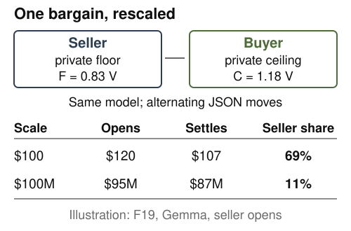
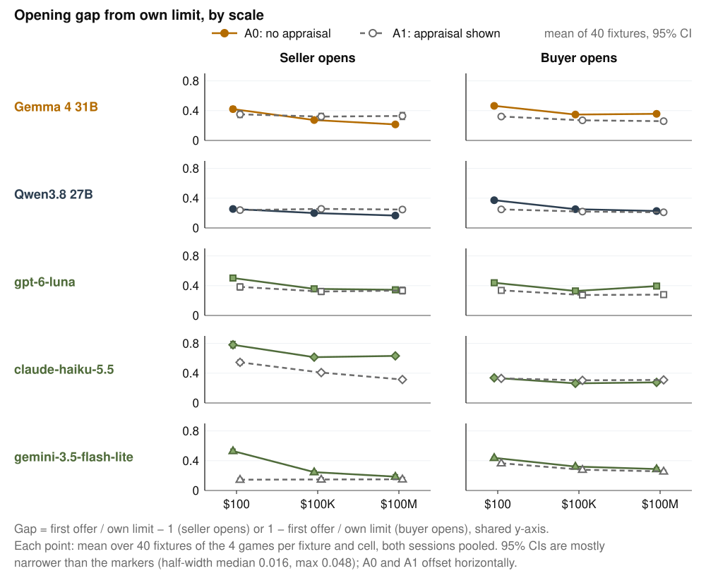
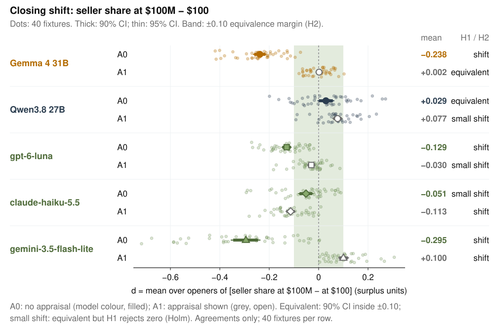
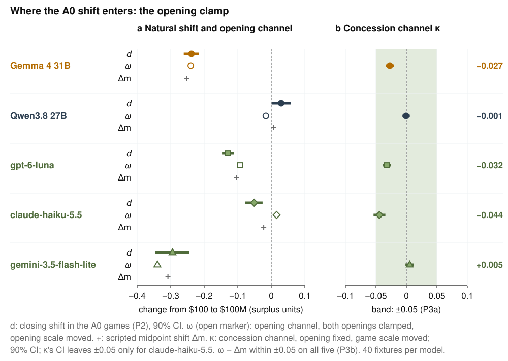
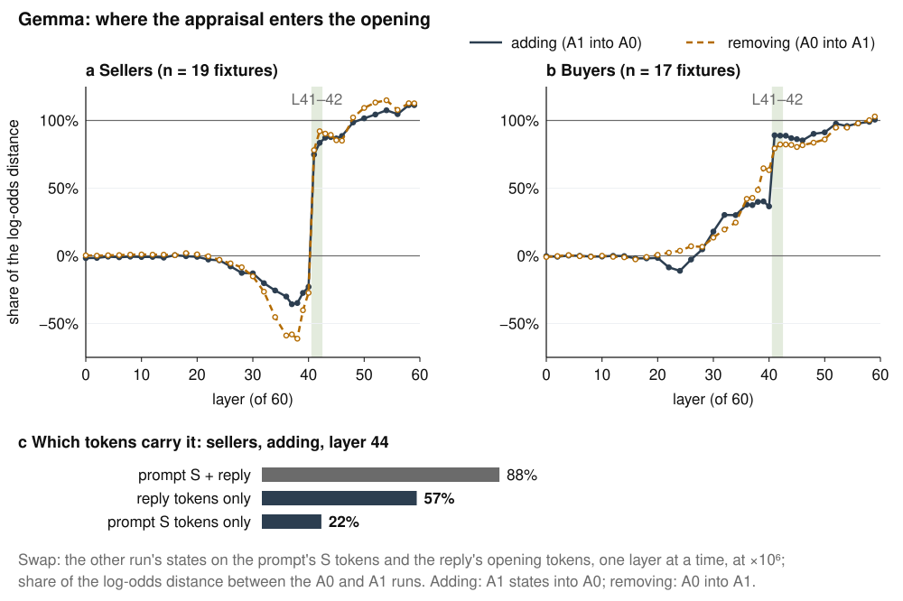
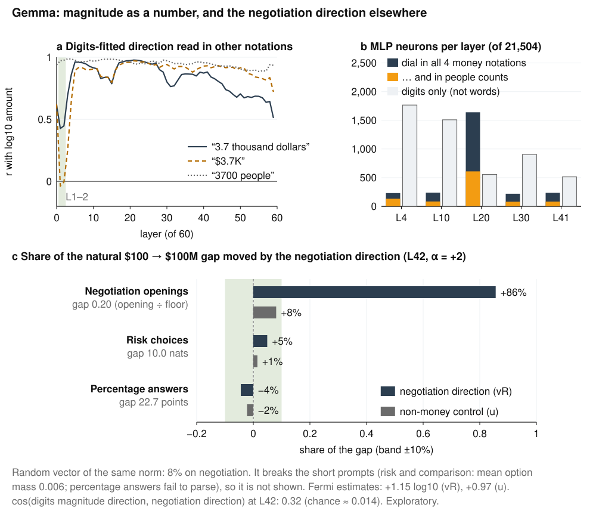

> **Interactive companion:** [https://shelltoho.me/pubs/multiply-by-a-million/](https://shelltoho.me/pubs/multiply-by-a-million/)  
> **Main Paper PDF (14 pages):** [`papers/multiply-by-a-million.pdf`](multiply-by-a-million.pdf) · **Supplementary Appendix:** [`papers/appendix.md`](appendix.md) ([PDF, 38 pages](appendix.pdf))

Preprint · Not peer reviewed

# Multiply by a Million: Scale Invariance in LLM Negotiators

Matt E. West · matt@shelltoho.me · ORCID 0009-0008-5557-9394

## Abstract

People take more risk with small stakes and discount large amounts less; we ask whether LLM negotiators, whose task is identical at every scale, also respond to scale. We test this in a study of five models (Gemma 4 31B, Qwen3.8 27B, gpt-6-luna, claude-haiku-5.5 and gemini-3.5-flash-lite), each playing 3,200 self-play games on 40 randomly drawn price ranges at $100, $100K and $100M, with and without a public appraisal of the lot and with an opening clamp that scripts both first offers. Without the appraisal, every model opens closer to its own limit at $100M. On all five, deals follow the scripted openings' midpoint. The appraisal reduces the opening effect on four models and removes Gemma's closing shift (from −0.238 to +0.002 of the surplus), but it is not a general remedy: it reverses the shift on Gemini and enlarges it on Haiku. Mechanistically, an exploratory analysis found the appraisal takes over Gemma's opening at layer 41 of 60, on the tokens that write the price, through attention heads that largely also carry the scale and private-range effects. Ultimately, this study shows that evaluating an agent at one numerical scale does not certify it at another.

## 1 Introduction

People do not treat a bargain a million times larger as the same bargain. They gamble on small stakes and turn cautious on large ones (Markowitz, 1952; Weber and Chapman, 2005), grow more risk averse as payoffs are scaled up (Holt and Laury, 2002), and discount large delayed amounts less than small ones (Thaler, 1981); Prelec and Loewenstein trace these effects to a common source (Prelec and Loewenstein, 1991). Large language models learn from human text and may inherit such stake effects.

LLM agents are increasingly evaluated as negotiators (Bianchi et al., 2024; Abdelnabi et al., 2023; Zhu et al., 2026), usually within one range of prices. A basic robustness question is whether the same bargain, written with every monetary amount a million times larger, produces the same relative offers and the same division of surplus. For negotiators whose utility is linear in money, rescaling leaves the Nash and Rubinstein solutions unchanged (Nash, 1950; Rubinstein, 1982); a person with concave utility need not be indifferent. Our task removes that reason. It gives the negotiator no wealth, budget or time cost, only a private limit and the goal of the best price, so a deal at the same share of the surplus is equally good at every scale. Invariance is the benchmark the task itself sets, and a departure means the model brings in a stake effect, or a number-handling effect, that the task does not ask for.

One observed bargain shows what can go wrong (Figure 1). Gemma 4 31B, selling with a private floor of $83 to a buyer with a ceiling of $118, opened at $120 and kept 69% of the surplus. With limits of $83M and $118M, the same words and the same sampling seed, it opened at $95M and kept 11%.

> **Figure:** Figure 1. A fixed-geometry bargaining test. The same fixture rescaled from $100 to $100M. Each side sees only its own limit; both openers are tested. The game shown is from the discovery phase (Gemma, Study 2, fixture F19, seller opening) and illustrates the question; the evidence comes from paired comparisons across fixtures.

Earlier exploratory and registered studies of this game (the discovery phase, Section 3 and Appendix D) suggested a specific account: at large amounts the opener asks for less; deals settle near the midpoint of the two first offers; and a public reference number such as an appraisal may remove the effect. This paper reports Study 3, a single account, under one protocol, on five models and on bargains no earlier run used. Its hypotheses, analysis code and scripted opening values were frozen and hashed before the first game, and every registered test is reported.

We find:

- Opening modesty at scale is shared (Section 5.1). Without the appraisal, all five models open closer to their own limit at $100M than at $100. The appraisal reduces this on four models; on Haiku it does not.

- Closing shifts follow the openings (Section 5.3). Scripting both first offers at their $100M positions shifts deals by the change in the scripted midpoint, within ±0.05 of the surplus, on all five models (informatively on Gemma, Luna and Gemini); with the openings fixed, concessions add a small shift on Gemma and Luna and a larger one on Haiku.

- A reference number is not a general fix (Section 5.2). The appraisal removes Gemma's shift and shrinks Luna's, but reverses Gemini's and enlarges Haiku's.

- Inside Gemma, the reference takes over late (Section 6, exploratory). The appraisal becomes decisive at layer 41 of 60, on the reply's price-writing tokens, through attention heads that largely also carry the scale and private-range effects, while the scale signal persists with less effect on the price.

- The scale signal looks like numerical magnitude, not stakes (Section 6.1, exploratory). Gemma reads amounts on one number line in five notations and loses its preference for better gambles at $100M, but the direction that shifts its openings moves its risky choices by 5% of that gap.

The scope is specific: five models, one prompt family, one single-issue game, self-play, thinking off or minimised. We separate registered primary tests, registered secondaries and exploratory analyses throughout.

## 2 Related work

Inside bargaining theory, the more risk-averse party receives less under the Nash solution (Kihlstrom et al., 1981), so a stake-dependent risk attitude is one route by which scale could move a split. Human bargaining studies find mixed stake-size effects (Andersen et al., 2011; Larney et al., 2019; Karagözoğlu and Urhan, 2017). For LLMs, multiplying every payoff in a repeated Prisoner's Dilemma while preserving its structure produces model-specific responses (Huynh et al., 2026); dictator and ultimatum studies likewise find heterogeneous stake effects (Polachek et al., 2026; Araujo and Uhlig, 2026). We extend the fixed-structure manipulation to a continuous price negotiated over multiple turns.

LLM negotiators have been studied in self-play and in arenas (Fu et al., 2023; Bianchi et al., 2024; Abdelnabi et al., 2023; Zhu et al., 2026). Two bargaining studies vary the value at stake, and in both the magnitude moves together with the geometry: doubling a retail price with cost fixed triples the margin (Liang and Xu, 2026), and limits drawn from items' historical prices make the dollar level and the width of the zone of agreement vary together (Bergemann et al., 2026). A self-play study that varies the zone's width finds model-specific crossovers between buyer and seller advantage (Ríos et al., 2025); a house-sale study varies whether a description of the house and comparable sales are shown, close to our appraisal contrast, but not the magnitude (Shah et al., 2025).

First offers predict negotiated outcomes in people (Galinsky and Mussweiler, 2001; Schweinsberg et al., 2023; Lipp et al., 2023) and can anchor LLM negotiations (Takenami et al., 2025). This motivates the midpoint account but does not establish it for our game, which the opening clamp tests directly. Inside models, number values are linearly decodable (Zhu et al., 2024), alongside digit-wise and helical codes (Levy and Geva, 2024; Kantamneni and Tegmark, 2025); irrelevant numeric anchors have been localised to sparse circuits whose depth differs by model family (Owusu et al., 2026). Our mechanistic methods build on activation patching and difference-vector steering (Heimersheim and Nanda, 2024; Turner et al., 2023; Zou et al., 2023).

## 3 Hypotheses and where they came from

Study 3's hypotheses were generated in a discovery phase of two registered studies, three registered addenda and exploratory probes, all reported in Appendix D. Table 1 lists what each suggested and which Study 3 test checks it. No discovery data enter a primary test; they fix only the hypotheses, the margins and the scripted opening values, and the descriptive secondary S8 compares Study 3 with them.

| Discovery-phase observation | Source (Appendix D) | Study 3 test |
| --- | --- | --- |
| Without an appraisal, openers move toward their own limit at $100M | Qwen Study 2 (exploratory); Addendum A on Gemma and Addendum B on three API models (registered) | S1 (h(A0)

Two gaps in the discovery phase motivated a new study rather than another addendum. In the registered studies, Gemma and the API models never saw an appraisal, so the remedy had been tested only on Qwen, together with the limit ranges. And the protocol changed between runs (one game per cell or four, blocked or interleaved order, 512 or 1,024 output tokens), so cross-model comparisons were confounded with procedure.

## 4 Study 3 design

Game. Two copies of a model negotiate one price. The seller knows a private floor F, the buyer a private ceiling C, and both know a deal is possible. They alternate JSON moves (OFFER a whole-dollar price, ACCEPT the standing offer, or WALKAWAY) with a message of at most 500 characters, for at most 16 messages. Each call is rebuilt from the rules, the side's own limit and the public history. Invalid replies forfeit the game without repair. For a deal at P, seller share is s = (P − F)/(C − F).

Fixtures and scales. Forty fresh fixtures (G01–G40) from a public seeded generator place floors at 75–95% and ceilings at 105–125% of a reference value V. Each is played at V = $100, $100K and $100M. Money is always written as digits followed by "dollars"; with the digits masked, the prompts at the three scales are identical.

Conditions (Table 2). The core grid crosses the appraisal (A0: no appraisal, Study 2's prompt; A1: one added line, "An independent appraisal values the lot at V. Both sides know this.") with scale and opener. The opening clamp, in A0 only, scripts both first offers into the public history and lets the model begin playing at message 3, at game scale G across the scripted opening scale O. The scripted positions are each model's mean first-offer positions in its own earlier no-appraisal games, in zone units. At $100M they are the $100 prices with six zeros appended.

| Block | Cells | Games per model |
| --- | --- | --- |
| Core grid | appraisal (A0, A1) × scale ($100, $100K, $100M) | 1,920 |
| Opening clamp (A0) | game scale G ($100, $100M) × scripted opening scale O ($100, $100M) | 1,280 |
| Total | 10 cells × 2 openers × 40 fixtures × 4 | 3,200 |

Models. Qwen3.8 27B (FP8) and Gemma 4 31B (bf16) run on pinned weights in vLLM 0.30.0 with each family's non-thinking sampling settings and no repetition penalties. gpt-6-luna, claude-haiku-5.5 and gemini-3.5-flash-lite (hereafter Luna, Haiku and Gemini) run through OpenRouter on each vendor's own endpoint with vendor sampling defaults and thinking off; Gemini's lowest setting, "minimal", does not guarantee zero reasoning, so its reasoning tokens were counted (none were reported). Sampling stays model-native; "one protocol" means every procedural rule is identical. Seeds are shared across scale, appraisal and clamp cell, so every within-fixture contrast shares them (Anthropic receives none; Appendix C).

Sessions. Each model ran in two independent sessions (samples 1–2 and 3–4): separate GPU pods for the open-weight models, separate days for the API models. Each session interleaved all cells in one fixed shuffle.

Tests. The fixture is the unit of analysis; a cell's value is the mean over its four games (agreements only, for seller share).

- P1 (openings). With g the opener's first-offer gap from its own limit, hf(A) = mean over openers of g($100M) − g($100), and If = hf(A1) − hf(A0). One-sided Wilcoxon, I > 0.

- P2 (closing shift). di = s($100M) − s($100), averaged over openers, per condition. A two-sided Wilcoxon (H1) and equivalence if the 90% bootstrap CI lies within ±0.10 (H2) (Lakens, 2017). A non-significant H1 is never read as equivalence.

- P3 (decomposition, A0). The concession channel κ is the scale effect with both openings held at the same scripted positions, averaged over the opening scale; "openings suffice" predicts κ equivalent to zero within ±0.05. The opening channel ω is the effect of moving the scripted openings from their $100 to their $100M positions, averaged over the game scale; "deals follow the scripted midpoint" predicts ω − Δm equivalent to zero within ±0.05, where Δm is the shift in the scripted offers' midpoint.

Wilcoxon p-values use 200,000 random sign flips; bootstrap intervals resample fixtures 10,000 times; Holm correction runs across the five models within each test. Nine registered secondaries (S1–S9) are reported in Appendix B.

Registration and data access. The registration, the files the study executes or reads (37 in all, including the analysis code and the scripted opening values) and their SHA-256 hashes were committed before any registered game; every session recorded the commit and checked the hashes. The registration was not lodged with an external registry (Appendix A). Format pilots on separate fixtures were judged on format only. One rule was set after the first API pilot, which was then rerun under it, and before the freeze: text after the first complete JSON object is ignored and flagged, rather than forfeiting the game. After the open-weight sessions, and before the second API session, we looked at Gemma and Qwen through the frozen analysis; this access was committed to a log first, the API outcome data stayed unexamined, and nothing in the protocol changed (Appendix A).

## 5 Results

All 16,000 games were scored and every game record reproduces exactly from the raw calls. Luna forfeited 35 games (34 truncated replies); no other model forfeited. Table 3 scores every registered primary test against its prediction: 21 of 25 are met.

| Model | P1 · I > 0 | P2 · A0 shift or equivalence | P2 · A1 equivalence | P3a · κ ≈ 0 | P3b · ω − Δm ≈ 0 |
| --- | --- | --- | --- | --- | --- |
| Gemma 4 31B | ✓ +0.114 [+0.100, +0.129]; p
Mean over 40 fixtures [90% bootstrap CI]; p: Wilcoxon signed-rank (200,000 sign flips), Holm across the five models (P1 one-sided). Predictions (registration §5.1): P1 I > 0 on all five; P2 A0 a shift on Gemma, Luna and Gemini (two-sided test) and equivalence within ±0.10 on Qwen and Haiku; P2 A1 equivalence within ±0.10 on all five; P3a κ and P3b ω − Δm equivalent to zero within ±0.05 (90% CI). A non-significant test is never read as equivalence. Total: 21 of 25.

### 5.1 Openings shrink at scale; the appraisal attenuates this on four models

Without the appraisal, every model's opener moves toward its own limit at $100M (S1: h from −0.101 on Luna to −0.247 on Gemini, all Holm-adjusted p

> **Figure:** Figure 2. Opening modesty by scale, with and without the appraisal. The opener's first-offer gap from its own limit at each scale (seller: ask ÷ floor − 1; buyer: 1 − offer ÷ ceiling), mean over 40 fixtures with 95% CIs. Solid: no appraisal (A0); dashed: appraisal shown (A1). P1 compares the $100M − $100 change between conditions; the $100K point is descriptive.

With the appraisal shown, Gemma's and Qwen's sellers open at a level that hardly moves with scale. Gemini's sellers open close to the appraisal itself (a gap of about 0.15 at every scale), while its buyers still drift toward their ceiling at large amounts.

### 5.2 Closing shifts: as predicted without the appraisal, model-dependent with it

Without the appraisal, the closing shift matches the registered prediction on all five models (Figure 3): seller share falls by 0.238 on Gemma, 0.129 on Luna and 0.295 on Gemini, while Qwen (+0.029) and Haiku (−0.051) meet equivalence within ±0.10. Haiku's shift is also significantly below zero (Holm p = 0.014) and larger than in the discovery phase (S8: +0.006 in Addendum C).

> **Figure:** Figure 3. Closing shift by model and appraisal condition (P2). Seller share at $100M minus at $100, per fixture (dots), with the mean, 90% CI (thick) and 95% CI (thin). Band: the registered ±0.10 equivalence margin.

With the appraisal, the prediction of equivalence on all five fails on two. Gemma's shift vanishes (+0.002 [−0.010, +0.014]). Qwen (+0.077) and Luna (−0.030) meet equivalence but show small, significant shifts. Gemini's shift reverses (+0.100 [+0.083, +0.119]): its sellers open next to the appraisal at every scale and settle low at $100, while its buyers open closer to their ceiling at $100M, so deals settle higher there. Haiku's shift grows (−0.113 [−0.131, −0.096]), consistent with its sellers' collapsing openings. In every model, deals under the appraisal track where the appraisal sits in the zone (S9: Spearman 0.75–0.98 across fixtures), so the appraisal works as an anchor; whether that anchor removes the scale effect depends on how each model's openings respond to it; on Gemma, Luna and Gemini the shift under the appraisal also rises with the appraisal's position in the zone (S9, ρ +0.40 to +0.56; descriptive).

### 5.3 The opening clamp: deals follow the openings

The clamp separates two channels (Figure 4). Moving the scripted openings from their $100 to their $100M positions, with the game's scale averaged out, shifts the deal by the amount the scripted midpoint predicts on every model, informatively on Gemma, Luna and Gemini (P3b:

ω − Δm within ±0.05 on all five). On Gemma, for example, ω = −0.240 against Δm = −0.253, close to its natural shift of −0.238; on Gemini, −0.340 against −0.308 and a natural −0.295. On Qwen and Haiku both terms are near zero, so P3b cannot distinguish its predictions there, as anticipated in the registration.

> **Figure:** Figure 4. Where the no-appraisal shift enters. (a) Natural closing shift d (90% CI), opening channel ω (open marker) and scripted midpoint shift Δm (cross). (b) Concession channel κ with 90% CI; band ±0.05.

Holding the openings fixed and changing only the game's scale leaves a concession channel κ within ±0.05 on four models. It is detectably negative on Gemma (−0.027) and Luna (−0.032): with identical openings, deals settle slightly lower at $100M. On Haiku κ is not shown equivalent to zero (−0.044 [−0.054, −0.034]; its 90% CI crosses the margin), so its behaviour at scale is not explained by openings alone; Haiku is also the one model whose natural deals track the first offers' midpoint only weakly (S5: Spearman 0.37, against 0.83–0.85 for the others).

Scripted openings are not natural ones. At $100M the scripted cells settle lower than natural games on Qwen (−0.069) and Gemini (−0.097; S6, both p

> **Figure:** Figure 5. Where the appraisal enters Gemma's opening (exploratory). (a) Sellers, 19 floors; (b) buyers, 17 ceilings. Share of the log-odds distance between the no-appraisal and appraisal runs moved by swapping one run's states into the other at one layer, at $100M; adding (appraisal states into the no-appraisal run) and removing. Band: layers 41–42. (c) Token split at layer 44, sellers, adding.

Largely the same heads as the scale and range effects. Ranked on 7 discovery floors, six of the appraisal's top eight heads (at layers 39–43, four at 41) are among the eight heads that carried the scale and private-range effects in the discovery phase (chance about 0.5). Patching the eight heads from the appraisal run moves the no-appraisal $100M opening toward the $100 opening on all 12 held-out floors, by about two-thirds of the scale gap (a post hoc measure), while eight random heads move almost nothing. The pre-committed held-out "share" (E5-5) is not interpretable, because its denominator changes sign across floors; the head-overlap half of E5-5 and the direct effect are the results we rely on.

### 6.1 Number or stakes? (E6)

If the opening shift is a stake effect, the direction that carries it should also move choices where the stakes matter but negotiation does not. If it is a number effect, it should carry the size of the number and little else. E6 tests this in two parts, with ten predictions committed before the run (Table 26).

Gemma reads magnitude the same way in five notations. We recorded Gemma's states on 360 one-sentence statements of an amount (nine mantissas × 10⁰ to 10⁷) in five notations: "3700 dollars", "3.7 thousand dollars", "$3.7K", "$3,700" and "3700 people". At the sentence's last token, a magnitude direction fitted on the digit sentences alone reads the log amount of the word and abbreviated sentences at r = 0.97 and 0.96 by layer 20 (Figure 6a; E6-2). This looks computed rather than lexical: at layers 1–2 the same direction reads "$3.7K" at r ≈ 0 and "3.7 thousand dollars" at 0.43–0.45, and the shared code forms between layers 3 and 5 (E6-3). Among MLP neurons, 1,640 of 21,504 at layer 20 rise or fall with the amount in all four money notations (|Spearman ρ| ≥ 0.8), and 609 of them also track head counts (Figure 6b).

Gemma has a stake effect of its own, in risky choices. Offered a sure amount or a 50% chance of twice that, or of 2.4 or 3 times that, Gemma at $100 takes the gamble when its expected value is higher (18 of 20). At $100M it no longer prefers the better gamble: its choices follow the listing order (the first-listed option in 18 of 20). Over 30 matched pairs of choices, the log-odds of the safe option rise by 10.0 nats (E6-5), in the direction people show when payoffs are scaled up (Holt and Laury, 2002).

The negotiation's scale direction barely moves it. We took the direction separating Gemma's $100M and $100 seller openings at layer 42 (from E5's 19 fixtures; leave-one-fixture-out on negotiation prompts), added it to the model's turn on other tasks' $100 prompts, and measured the share of each task's natural $100 → $100M gap it reproduced (Figure 6c). It moves negotiation openings 86% of the way, against 8% for a random vector of the same norm (E6-1), but moves risky choices 5% and percentage answers −4%, far short of the predicted 25% (non-money control 1% and −2%; E6-6 and E6-7 missed). It leaves comparisons and sums intact (E6-8). It does make numbers larger: Fermi estimates rise by 1.15 orders of magnitude at α = +2 and fall by 0.50 at −2 (E6-9 missed), driven by three of ten items that jump by two to five orders of magnitude. The control direction does the same (+0.97), so this leak is not specific to the negotiation direction. The negotiation direction also overlaps the plain-sentence magnitude direction (cosine 0.32 at layer 42, against about 0.014 by chance; E6-10 missed at its 0.2 threshold).

With E5, this places Gemma's scale effect. Magnitude is read early and the same way in five notations; a late stage at layers 41–44 uses it to set the price, and a competing reference number (the private range or the appraisal) can take over there. The direction that shifts the openings behaves more like a signal of numerical magnitude than of stakes: adding it reproduces 5% of Gemma's stake effect in risky choices. In this model the opening shift looks like a number effect applied by the negotiation, not an imported risk preference. This rests on one model, one steering placement and two layers.

Appendix F reports three scoring artefacts (E6-4 is met trivially, the exponent-tuning count cannot reach its threshold, and the random control breaks the short prompts).

> **Figure:** Figure 6. Magnitude as a number, and the negotiation direction in other tasks (Gemma, exploratory). (a) Correlation with log amount of the projection onto a magnitude direction fitted on digit sentences, read in three other notations, by layer. (b) MLP neurons whose activation follows the amount (|ρ| ≥ 0.8) in all four money notations, the subset that also follows head counts, and neurons that follow digits but not words. (c) Share of each task's natural $100 → $100M gap moved by adding the negotiation scale direction or a non-money control at layer 42, α = +2, on $100 prompts.

## 7 Discussion

What the models comprehend. The models are not blind to magnitude. Gemma reads amounts on one number line in five notations by layer 5 (Section 6.1), and its scale signal persists, with less effect on the price, under the appraisal (Section 6). What changes with scale is the opening, and outcomes follow the openings: deals follow the scripted openings on every model, and on the three models whose split moves, the openings account for most of the shift. The departure is therefore a policy that maps larger absolute amounts to more modest relative opening positions, not a failure to read the numbers. It resembles the stake effects people show, and Gemma has one in risky choices; but in Gemma the direction that shifts the openings barely moves those choices, and behaves more like a signal of numerical magnitude.

Whose stake preferences? A person selling a $100M asset may reasonably be more cautious than one selling a $100 one. An agent acting for that person has not been told to be. Caution alone also cannot move a self-play split: when both sides share the same utility over their gains, the Nash solution divides the surplus equally at every scale, however risk averse they are (Nash, 1950; Kihlstrom et al., 1981). The closing shifts therefore need an asymmetry between roles, and Study 3 shows one. Without the appraisal, from $100 to $100M the sellers' opening gap narrows two to three and a half times as much as the buyers' on the three models whose split shifts (Gemma 0.21 against 0.11, Luna 0.16 against 0.04, Gemini 0.34 against 0.15). Haiku shows a similar imbalance (0.15 against 0.06) with a smaller shift (−0.051), and its deals track the opening midpoint least (S5), so the imbalance alone does not set the size of the shift. For deployment the question is less whether a model is rational than whether it brings in a preference its principal did not state.

Self-play invariance is not robustness. Qwen's and Haiku's no-appraisal splits meet equivalence, yet their openers still move toward their limits at scale. In self-play, modesty on both sides can offset in the split; against a counterpart that does not share it, the same policy could lose surplus (untested here). An evaluation that checks only outcomes at one scale, or only self-play at several, would miss this.

A reference number is an anchor, not a cure. The appraisal's effect is model-specific. It anchors every model's deals to its position in the zone, but what it does to the openings at scale differs: it holds Gemma's and Qwen's sellers' openings nearly level, draws Gemini's sellers to just below the appraisal, and leaves Haiku's sellers to collapse further. For Gemma's sellers it acts at the same narrow stage as the scale effect itself, through largely the same heads, on the tokens that write the price. That suggests a single late stage at which a number in context, a limit or an appraisal, can set the price. This is one model and an exploratory analysis; it describes where the intervention acts, not a semantic explanation of the model's numerical representation.

For evaluation. Agent evaluations that use one price range should report openings as well as outcomes and test at more than one scale. Our design (fixed geometry, shared seeds, an opening clamp) is cheap: Study 3 cost about $17 in API fees and $11 in GPU time.

## 8 Limitations

The five models are not a representative sample; their precisions and sampling settings differ, so cross-model comparisons are descriptive. All games use one prompt family and one single-issue task, in self-play, with thinking off or minimised. Prices are whole dollars, which discretises the $100 scale. Each scale change also changes the digit strings; the discovery phase attributes part of the opening effect to the digits rather than the stakes (Appendix D.5). The appraisal is one wording at one place in the prompt.

The hypotheses were informed by earlier data on the same models, so Study 3 confirms them on new bargains, not on new models. An interim look at Gemma and Qwen preceded the second API session; it was logged and changed nothing, but it is a departure from a fully blind sequence. Games with scripted openings settle lower than natural games on Qwen and Gemini at $100M (S6). API results concern the dated versions returned on 14–15 October 2026. The registration is a local hashed commit, not lodged with an external registry, so its timing rests on the local history and the session manifests (Appendix A).

The mechanistic analysis covers one model, first moves only and the prompts of 19 seller floors and 18 buyer ceilings, using a forced-opening readout that does not lie on the axis of the appraisal's own openings; that is why one pre-committed share is uninterpretable. Its predictions were committed, but it is exploratory. E6 adds one steering placement (the model's turn) at two layers; a stake signal elsewhere in the network, or one read from the prompt itself, is not excluded. Stake effects outside negotiation were measured on Gemma only.

## 9 Reproducibility and disclosure

The registration, hashed inputs, data-access log, analysis code and figure and table generators are under version control in the project repository (Appendix A). The raw call and game records, session manifests and derived files are kept with it, hashed in each run summary, and will be released with the code; every game record replays from its raw calls. The E5 and E6 predictions files were committed before their runs, and their hashes are recorded in the run manifests. AI tools assisted with code, analysis, figures, and checking prose. The author retains responsibility for the final text, factual verification and interpretation; AI tools are not authors (arXiv, 2025).

## References

- Sahar Abdelnabi, Amr Gomaa, Sarath Sivaprasad, Lea Schönherr, Mario Fritz (2023). Cooperation, Competition, and Maliciousness: LLM-Stakeholders Interactive Negotiation. arXiv preprint. [https://arxiv.org/abs/2309.17234](https://arxiv.org/abs/2309.17234)
- Andersen, Steffen, Ertaç, Seda, Gneezy, Uri, Hoffman, Moshe, List, John A (2011). Stakes Matter in Ultimatum Games. American Economic Review. [https://doi.org/10.1257/aer.101.7.3427](https://doi.org/10.1257/aer.101.7.3427)
- Araujo, Douglas, Uhlig, Harald (2026). How does AI Distribute the Pie? Large Language Models and the Ultimatum Game. National Bureau of Economic Research. [https://doi.org/10.3386/w34919](https://doi.org/10.3386/w34919)
- Yonatan Belinkov (2021). Probing Classifiers: Promises, Shortcomings, and Advances. arXiv preprint. [https://arxiv.org/abs/2102.12452](https://arxiv.org/abs/2102.12452)
- Dirk Bergemann, Soheil Ghili, Xinyang Hu, Chuanhao Li, Zhuoran Yang (2026). Training Language Models for Bilateral Trade with Private Information. arXiv preprint. [https://arxiv.org/abs/2604.16472](https://arxiv.org/abs/2604.16472)
- Federico Bianchi, Patrick John Chia, Mert Yuksekgonul, Jacopo Tagliabue, Dan Jurafsky, James Zou (2024). How Well Can LLMs Negotiate? NegotiationArena Platform and Analysis. arXiv preprint. [https://arxiv.org/abs/2402.05863](https://arxiv.org/abs/2402.05863)
- Ahmed Oumar El-Shangiti, Tatsuya Hiraoka, Hilal AlQuabeh, Benjamin Heinzerling, Kentaro Inui (2024). The Geometry of Numerical Reasoning: Language Models Compare Numeric Properties in Linear Subspaces. arXiv preprint. [https://arxiv.org/abs/2410.13194](https://arxiv.org/abs/2410.13194)
- Yao Fu, Hao Peng, Tushar Khot, Mirella Lapata (2023). Improving Language Model Negotiation with Self-Play and In-Context Learning from AI Feedback. arXiv preprint. [https://arxiv.org/abs/2305.10142](https://arxiv.org/abs/2305.10142)
- Galinsky, Adam D., Mussweiler, Thomas (2001). First offers as anchors: The role of perspective-taking and negotiator focus. Journal of Personality and Social Psychology. [https://doi.org/10.1037/0022-3514.81.4.657](https://doi.org/10.1037/0022-3514.81.4.657)
- Stefan Heimersheim, Neel Nanda (2024). How to use and interpret activation patching. arXiv preprint. [https://arxiv.org/abs/2404.15255](https://arxiv.org/abs/2404.15255)
- Holt, Charles A., Laury, Susan K. (2002). Risk Aversion and Incentive Effects. American Economic Review. [https://doi.org/10.1257/000282802762024700](https://doi.org/10.1257/000282802762024700)
- Trung-Kiet Huynh, Dao-Sy Duy-Minh, Thanh-Bang Cao, Phong-Hao Le, Hong-Dan Nguyen, Phu-Quy Nguyen-Lam et al. (2026). Payoff scaling shapes cooperation in LLM agents across languages. arXiv preprint. [https://arxiv.org/abs/2601.19082](https://arxiv.org/abs/2601.19082)
- Subhash Kantamneni, Max Tegmark (2025). Language Models Use Trigonometry to Do Addition. arXiv preprint. [https://arxiv.org/abs/2502.00873](https://arxiv.org/abs/2502.00873)
- Karagözoğlu, Emin, Urhan, Ümit Barış (2017). The Effect of Stake Size in Experimental Bargaining and Distribution Games: A Survey. Group Decision and Negotiation. [https://doi.org/10.1007/s10726-016-9490-x](https://doi.org/10.1007/s10726-016-9490-x)
- Kihlstrom, Richard E., Roth, Alvin E., Schmeidler, David (1981). Risk Aversion and Solutions to Nash's Bargaining Problem. Game Theory and Mathematical Economics.
- Lakens, Daniël (2017). Equivalence Tests: A Practical Primer for t Tests, Correlations, and Meta-Analyses. Social Psychological and Personality Science. [https://doi.org/10.1177/1948550617697177](https://doi.org/10.1177/1948550617697177)
- Larney, Andrea, Rotella, Amanda, Barclay, Pat (2019). Stake size effects in ultimatum game and dictator game offers: A meta-analysis. Organizational Behavior and Human Decision Processes. [https://doi.org/10.1016/j.obhdp.2019.01.002](https://doi.org/10.1016/j.obhdp.2019.01.002)
- Paraskevas V. Lekeas, Giorgos Stamatopoulos (2026). How a Cooperative-Override Circuit Suppresses Nash Play in Large Language Models. arXiv preprint. [https://arxiv.org/abs/2604.27167](https://arxiv.org/abs/2604.27167)
- Amit Arnold Levy, Mor Geva (2024). Language Models Encode Numbers Using Digit Representations in Base 10. arXiv preprint. [https://arxiv.org/abs/2410.11781](https://arxiv.org/abs/2410.11781)
- Chen Liang, Fasheng Xu (2026). When LLM Agents Negotiate: Private Information and Dynamic Bargaining in Supply Chains. arXiv preprint. [https://arxiv.org/abs/2608.07538](https://arxiv.org/abs/2608.07538)
- Lipp, Wolfram E., Smolinski, Remigiusz, Kesting, Peter (2023). Beyond the First Offer: Decoding Negotiation Openings and Their Impact on Economic and Subjective Outcomes. Group Decision and Negotiation. [https://doi.org/10.1007/s10726-023-09813-5](https://doi.org/10.1007/s10726-023-09813-5)
- Markowitz, Harry (1952). The Utility of Wealth. Journal of Political Economy. [https://doi.org/10.1086/257177](https://doi.org/10.1086/257177)
- Nash, John F. (1950). The Bargaining Problem. Econometrica. [https://doi.org/10.2307/1907266](https://doi.org/10.2307/1907266)
- Hillary N. Owusu, Sarah Wiegreffe, Naomi H. Feldman (2026). Localizing Anchoring Pathways in Language Models. arXiv preprint. [https://arxiv.org/abs/2606.12818](https://arxiv.org/abs/2606.12818)
- Polachek, Solomon, Romano, Kenneth, Tonguc, Ozlem (2026). Strategic Reasoning and Sensitivity to Stakes in the Dictator and Ultimatum Games: LLMs vs. Human Proposers. IZA Institute of Labor Economics.
- Prelec, Drazen, Loewenstein, George (1991). Decision Making Over Time and Under Uncertainty: A Common Approach. Management Science. [https://doi.org/10.1287/mnsc.37.7.770](https://doi.org/10.1287/mnsc.37.7.770)
- Rubinstein, Ariel (1982). Perfect Equilibrium in a Bargaining Model. Econometrica. [https://doi.org/10.2307/1912531](https://doi.org/10.2307/1912531)
- Manuel S. Ríos, Ruben F. Manrique, Nicanor Quijano, Luis F. Giraldo (2025). The Illusion of Rationality: Tacit Bias and Strategic Dominance in Frontier LLM Negotiation Games. arXiv preprint. [https://arxiv.org/abs/2512.09254](https://arxiv.org/abs/2512.09254)
- Schweinsberg, Martin, Petrowsky, Hannes M., Funk, Burkhardt, Loschelder, David D. (2023). Understanding the first-offer conundrum: How buyer offers impact sale price and impasse risk in 26 million eBay negotiations. Proceedings of the National Academy of Sciences. [https://doi.org/10.1073/pnas.2218582120](https://doi.org/10.1073/pnas.2218582120)
- Cheril Shah, Akshit Agarwal, Kanak Garg, Mourad Heddaya (2025). LLM Rationalis? Measuring Bargaining Capabilities of AI Negotiators. arXiv preprint. [https://arxiv.org/abs/2512.13063](https://arxiv.org/abs/2512.13063)
- Aaditya K. Singh, DJ Strouse (2024). Tokenization counts: the impact of tokenization on arithmetic in frontier LLMs. arXiv preprint. [https://arxiv.org/abs/2402.14903](https://arxiv.org/abs/2402.14903)
- Yoshiki Takenami, Yin Jou Huang, Yugo Murawaki, Chenhui Chu (2025). How Does Cognitive Bias Affect Large Language Models? A Case Study on the Anchoring Effect in Price Negotiation Simulations. arXiv preprint. [https://arxiv.org/abs/2508.21137](https://arxiv.org/abs/2508.21137)
- Daniel Tan, David Chanin, Aengus Lynch, Dimitrios Kanoulas, Brooks Paige, Adria Garriga-Alonso et al. (2024). Analyzing the Generalization and Reliability of Steering Vectors. arXiv preprint. [https://arxiv.org/abs/2407.12404](https://arxiv.org/abs/2407.12404)
- Thaler, Richard (1981). Some empirical evidence on dynamic inconsistency. Economics Letters. [https://doi.org/10.1016/0165-1765(81)90067-7](https://doi.org/10.1016/0165-1765(81)90067-7)
- Alexander Matt Turner, Lisa Thiergart, Gavin Leech, David Udell, Juan J. Vazquez, Ulisse Mini et al. (2023). Steering Language Models With Activation Engineering. arXiv preprint. [https://arxiv.org/abs/2308.10248](https://arxiv.org/abs/2308.10248)
- Weber, Bethany J., Chapman, Gretchen B. (2005). Playing for peanuts: Why is risk seeking more common for low-stakes gambles?. Organizational Behavior and Human Decision Processes. [https://doi.org/10.1016/j.obhdp.2005.03.001](https://doi.org/10.1016/j.obhdp.2005.03.001)
- Fangwei Zhu, Damai Dai, Zhifang Sui (2024). Language Models Encode the Value of Numbers Linearly. arXiv preprint. [https://arxiv.org/abs/2401.03735](https://arxiv.org/abs/2401.03735)
- Chris Zhu, Sasha Cui, Will Sanok Dufallo, Runzhi Jin, Zhen Xu, Linjun Zhang et al. (2026). PieArena: Ranking and Profiling Language Agents in Realistic Negotiation Scenarios. arXiv preprint. [https://arxiv.org/abs/2602.05302](https://arxiv.org/abs/2602.05302)
- Andy Zou, Long Phan, Sarah Chen, James Campbell, Phillip Guo, Richard Ren et al. (2023). Representation Engineering: A Top-Down Approach to AI Transparency. arXiv preprint. [https://arxiv.org/abs/2310.01405](https://arxiv.org/abs/2310.01405)
- arXiv (2025). Policy for authors' use of generative AI language tools (arXiv moderation / content policy). arXiv Content Moderation Policy page. [https://info.arxiv.org/help/moderation/index.html#policy-for-authors-use-of-generative-ai-language-tools](https://info.arxiv.org/help/moderation/index.html#policy-for-authors-use-of-generative-ai-language-tools)

---

## Supplementary Appendix

Appendices A-F (registration, full Study 3 tables, protocol details, discovery phase, E5 methods/results, and E6 methods/results) are provided separately in [`papers/appendix.md`](appendix.md) and [`papers/appendix.pdf`](appendix.pdf).
